# Authentication and authorization

Every security boundary is enforced by the backend. The frontend only decides what to
display.

## Authentication

**Built in Phase 1** (the design decisions are in [ADR-0003](adr/0003-session-authentication.md),
[ADR-0013](adr/0013-account-lifecycle-and-one-time-tokens.md) and
[ADR-0014](adr/0014-durable-login-throttling.md)). Code:
[`identity/authentication.py`](../backend/arkray/identity/authentication.py),
[`sessions.py`](../backend/arkray/identity/sessions.py),
[`throttling.py`](../backend/arkray/identity/throttling.py),
[`services.py`](../backend/arkray/identity/services.py).

### Mechanism

Server-side **Django sessions in PostgreSQL** with an HTTP-only cookie on a single origin.
No bearer token is ever exposed to JavaScript, localStorage or sessionStorage.

| Setting | Value | Why |
|---|---|---|
| `arkray_session` cookie | `HttpOnly`, `Secure` (production), `SameSite=Lax`, a **browser-session cookie** (no `Expires`/`Max-Age`: closing the browser ends it; privacy remediation, `identity.session_store`) | unreadable by scripts; not sent on cross-site subresource requests; a shared computer doesn't hand the next person an open session |
| Session storage | PostgreSQL (`django_session`) | a Redis outage never signs anyone out |
| Absolute lifetime | 12 h (`SESSION_COOKIE_AGE_S`); the row's expiry is pinned at sign-in, activity never extends it, and the middleware enforces it whatever the browser does | bounds the value of a stolen session |
| Idle timeout | 2 h (`SESSION_IDLE_TIMEOUT_S`); activity is recorded at most every 5 min | same, without a database write per request |
| Session key | always new on sign-in, including when the same user signs in again | no session fixation |
| Revocation | the session auth hash covers the password hash **and** `User.session_epoch`; Django re-checks it, and rejects inactive users, on every request | deactivation, password change, email change and a role change end sessions on the very next request, and they stay dead after reactivation |
| CSRF | the readable `arkray_csrftoken` cookie is echoed in `X-CSRFToken` (double submit), and `Origin` is checked against `CSRF_TRUSTED_ORIGINS`. `ApiView` enforces this on **every** unsafe request, signed in or not (DRF alone skips anonymous requests). | login CSRF and cross-site actions are refused |
| Unauthenticated | `401 not_authenticated` with `WWW-Authenticate: Session realm="arkray"` | clients can tell "sign in" (401) from "not allowed" (403) |
| Caching | every API response is `Cache-Control: no-store` | personal data is never cached |
| Password hashing | Argon2id (PBKDF2 accepted for upgrade) | |

A session without valid timestamps is treated as expired: deny by default.

### Endpoints

| Endpoint | Access | Behaviour |
|---|---|---|
| `GET /api/v1/auth/csrf` | public | sets the CSRF cookie (204) |
| `POST /api/v1/auth/login` | public | `{email, password}` → the viewer (200), or, for an account with a second factor, `202 {"mfa_required": true, "expires_in": 300}` and nothing signed in yet (see [Two-step verification](#two-step-verification)). Every failure returns the identical `400 invalid_credentials` "Invalid email or password.": unknown email, wrong password, invited (no password yet), deactivated, malformed email. The hasher runs in every case, against a decoy hash when there is no usable one, and a failure does the same database work whether or not the email has an account (adversarial review of 73ff1e3, L1: an unknown email's audit rows are written in a savepoint and rolled back), so timing reveals nothing either. Throttled attempts get `429` with `Retry-After`; an account locked by the daily cap answers `429 sign_in_locked` to unrecognised browsers (below). |
| `POST /api/v1/auth/login/mfa` | public (needs the pending challenge) | `{code}` or `{recovery_code}` → the viewer, like `login`. `400 invalid_mfa_code` / `400 mfa_challenge_expired` / `429` |
| `GET /api/v1/auth/mfa` | signed in | `{enabled, confirmed_at, recovery_codes_remaining, required, can_disable}` |
| `POST /api/v1/auth/mfa/setup` | signed in | `{current_password}` → `{secret, otpauth_uri, qr: {size, rows}}`, shown once; `409 mfa_already_enabled` |
| `POST /api/v1/auth/mfa/confirm` | signed in | `{code}` → `{recovery_codes: [10]}`; other sessions end |
| `POST /api/v1/auth/mfa/recovery-codes` | signed in | `{code}` → new `{recovery_codes}`; the old ones and other sessions end |
| `POST /api/v1/auth/mfa/disable` | signed in | `{current_password, code}` → 204; `422` where the role requires it |
| `POST /api/v1/auth/mfa/verify` | signed in | `{code}` or `{recovery_code}` → 204 (step-up) |
| `POST /api/v1/auth/logout` | public (idempotent) | deletes the session; audited when a user was signed in |
| `GET /api/v1/auth/me` | signed in | `{id, email, first_name, last_name, full_name, role, role_label, capabilities[], features, password_change_required, support_session, mfa_enabled, mfa_enrollment_required}`. `role` is `admin` ("Super admin"), `team_admin` ("Admin") or `sales_user` ("User") ([ADR-0035](adr/0035-super-administrators-and-teams.md)); `capabilities` lists what the role holds ([Roles → capabilities](#roles--capabilities-built)), and the web app decides what to show from them, never from the role |
| `POST /api/v1/auth/password/change` | signed in | `{current_password, new_password}`; throttled like sign-in; keeps this session (new key), ends all others, and voids any outstanding password-reset link |
| `POST /api/v1/auth/password-reset` | public | `{email}` → always `202` "If an eligible account exists, password reset instructions have been sent." |
| `POST /api/v1/auth/password-reset/confirm` | public | `{token, new_password}` → 204; every session ends; the user then signs in |
| `POST /api/v1/auth/invitations/verify` | public | `{token}` → `{email, first_name}` for a valid invitation (POST, so the secret never enters a URL on the API side) |
| `POST /api/v1/auth/invitations/accept` | public | `{token, password}` → activates the account; the user then signs in |
| `POST /api/v1/auth/sign-in-unlock/verify` | public (needs the emailed secret) | `{token}` → `{"email": "r***@example.com"}`: names the link's account, masked, before anything is done (the page shows it first); uses nothing up; throttled like the other link routes; `400 invalid_token` like them (adversarial review of 73ff1e3, its review round 1, IDENTITY-1) |
| `POST /api/v1/auth/sign-in-unlock` | public (needs the emailed secret) | `{token}` → 204: lifts the account's daily sign-in lock and trusts the browser that opened the link, unless that browser already holds a valid trust for another account, which is never replaced (the lock is lifted all the same; IDENTITY-1) (page `/unlock-sign-in/<token>`, 24 h, one use; [Sign-in throttling](#sign-in-throttling)) |

Invalid, used, superseded, revoked and expired links all get one answer:
`400 invalid_token` "This link is invalid or has expired. Ask for a new one."

### Sign-in throttling

Durable, PostgreSQL-backed ([ADR-0014](adr/0014-durable-login-throttling.md)), so it keeps
working during a Redis outage (tested). DRF's Redis-backed limits (`anon` 60/min, `auth`
20/min) sit in front as a fail-open first layer.

| Rule | Policy |
|---|---|
| Key | keyed HMAC of the *submitted*, normalised email, so unknown emails are throttled exactly like real ones and no email is stored |
| Per account and browser | 5 failures in 15 min → locked 1 min, doubling with each further failure, **capped at 15 min**. A browser that has signed in to the account before (signed `arkray_login_device` cookie, HttpOnly, `SameSite=Strict`, path `/api/v1/`, 90 days) has its **own** budget, so an attacker can't lock the owner out of their usual browser. The cookie holds keyed hashes and a random id only (nothing readable without the server's key; tested) and is **kept at sign-out** on purpose: clearing it would let an attacker's guesses lock a signed-out owner out (reviewed in the privacy remediation, ADR-0032). Unrecognised browsers share one budget **per network** (IPv4 /24, `LOGIN_NETWORK_IPV4_PREFIX`; IPv6 /64), so a storm from one network doesn't block the right password from another (adversarial review of 73ff1e3, L1; they shared one budget per account before). |
| Per account and day | `LOGIN_DAILY_FAILURE_CAP` (50) failures from unrecognised browsers within `LOGIN_DAILY_WINDOW_S` (24 h) lock the account's sign-in from **unrecognised** browsers (`identity_login_lock`): `429 sign_in_locked` with `Retry-After`, refused before the password check and identical for an unknown email; trusted browsers keep working. The owner is emailed an unlock link (`POST /api/v1/auth/sign-in-unlock`, 24 h, `SIGN_IN_UNLOCK_TTL_S`), which lifts it and trusts the browser that opened it (never in place of another account's trust in that browser); an email change, a password set by an administrator or changed by the owner, a reset and a reactivation revoke a pending one (review round 1, IDENTITY-2); a password reset, an accepted invitation, an administrator-set password, an administrator's `POST /api/v1/admin/users/{id}/clear-sign-in-lock` (`users.manage`, step-up, never in a support session; the lock shows as `sign_in_locked_at` on the users list and detail) or `LOGIN_LOCK_MAX_AGE_S` (30 days, hourly housekeeping, for every identifier alike) lift it too (L1: about 552 guesses a day per account went on indefinitely before) |
| Per source | 50 failures **from unrecognised browsers** in 15 min (colleagues' typos in their usual browsers don't count; L1) → unrecognised browsers from that source are blocked until the window moves (catches password spraying). The source is the trusted-proxy-aware client IP; an IPv6 address counts as its /64 (one subscriber); an unknown address (for example a proxy writing `unknown`) shares one bucket, so it fails closed. **Trusted browsers are exempt**, so a noisy neighbour behind the same office NAT can't lock the owner out. |
| Refused attempts | refused **before** the password is checked and not recorded: no oracle, bounded storage |
| Atomic reservations | each attempt first *reserves* a failure in a short transaction that holds advisory locks on the account and the source, checks both budgets and inserts the row; only then is the password checked (outside any transaction), and a correct password deletes the reservation. Parallel bursts can't exceed a budget, and nobody is refused just because another attempt is in flight. |
| Resets | a successful sign-in forgives that browser's failures (`forgiven`: they stop counting toward its lockout but still count toward the day; L1: deleting them let the owner's sign-in from a new browser reset the attacker's count); a completed reset or activation clears the account's buckets and its daily lock |
| Password-reset requests | 20 per source per hour (durable, reserved atomically like sign-in); at most 3 reset emails per account per hour (in the job; suppression is audited) |
| Key rotation | identifiers and trusted-browser cookies made with a key in `SECRET_KEY_FALLBACKS` still count and still match, so rotating the key neither lifts lockouts nor untrusts browsers |
| Audit | crossing a threshold is audited once (`auth.login_throttled`, target = identifier prefix, never the email). Each failed sign-in of an **existing** account is audited too (`auth.login_failed`, reason `wrong_password`, `account_inactive`, `wrong_code`, `wrong_recovery_code` or `mfa_locked`; shown in the security events; bounded by this throttle, since refused attempts aren't recorded). An unknown email is a log line only (its audit rows are written and rolled back, for equal work). The daily lock is audited `auth.sign_in_locked` and its lifting `auth.sign_in_unlocked` (by `email_link` or `administrator`), both in the security events; `arkray_sign_in_failures_last_hour` and `arkray_sign_in_locks_last_hour` raise `ArkraySignInFailureStorm` and `ArkraySignInLocked` ([runbooks.md](runbooks.md#security-events)). |
| Second factor | every wrong code (sign-in, step-up, replacing recovery codes, disabling) counts as a failed sign-in of the account from that browser. A right password with a second factor still to come withdraws only its own reservation: earlier failures stand until the code is right. Beyond the throttle's window, wrong codes also accumulate on the device and lock it at 20 (see [Two-step verification](#two-step-verification)). |
| Housekeeping | evidence older than 24 h is purged hourly (`identity.housekeeping`, which also clears expired sessions) |

### Account lifecycle

```mermaid
stateDiagram-v2
    [*] --> invited: admin creates user
    invited --> active: user accepts invitation (sets password)
    active --> deactivated: admin deactivates
    invited --> deactivated: admin deactivates (link revoked)
    deactivated --> active: admin reactivates (had a password)
    deactivated --> invited: admin reactivates (never activated; new invitation sent)
```



Every rule is a CHECK constraint on `identity_user` ([database.md](database.md#identity_user-built-lifecycle-added-in-phase-1)).
Users are **never deleted**: foreign keys are `PROTECT`, and history and ownership
references stay intact. "admin" in the diagram is either kind of administrator acting within
their reach: a super admin on any account, an Admin on their own team's users only
([User administration rules](#user-administration-rules)).

### Admin-set passwords

Since the product enhancement phase an administrator may create a user **with an initial
password** (`POST /admin/users {…, password}`) instead of an invitation, and may **set a new
password** for a user (`POST /admin/users/{id}/set-password {version, new_password}`). In
both cases ([ADR-0026](adr/0026-user-pipelines-support-sessions-attachments.md)):

- **who**: a super admin for any user; an Admin (team administrator,
  [ADR-0035](adr/0035-super-administrators-and-teams.md)) for the users of their own team
  only, whom they create with an initial password or set one for like a super admin does.
  Anyone outside the caller's reach is a 404, identical to an account that doesn't exist
  ([User administration rules](#user-administration-rules));
- the plaintext exists only in that request: the password policy runs, the hash is stored,
  and the password is never stored, logged, audited, queued, emailed or returned by any API
  (tested on logs, audit, outbox, mail and every response);
- the user **must choose their own password at first sign-in**
  (`password_change_required`): until then every API call except `GET /auth/me`, `POST
  /auth/password/change` and sign-out answers 403 `password_change_required`, and the UI
  shows only the change-password screen. An unchanged temporary password expires after
  `TEMPORARY_PASSWORD_TTL_S` (72 h; sign-in answers `temporary_password_expired`);
- setting a password ends the user's sessions and voids outstanding reset links; it is
  refused for oneself (Settings), for another administrator of either kind **whatever the
  account's status** (that would let one administrator sign in as another; see
  [Administrator account protection](#administrator-account-protection)), for an account
  another administrator took out of an administrator role in the last 7 days
  ("demote-then-unshield", same section), and for invited or deactivated users; audited as `auth.password_set_by_admin` (actor, user; never the
  password), and the account's own address is emailed that an administrator set a new
  password (no password in it; adversarial review of 73ff1e3, L3); the notice carries the
  address it was queued for and is sent whatever the account's status by then, so neither a
  quick deactivation and reactivation nor an email change right after suppresses or redirects
  it (review round 1, IDENTITY-3; the role-change and second-factor notices alike);
- **administrators of both kinds are always invited** (a password on create is refused for
  a role that manages users, Super admin or Admin; `identity.policy.administrator_roles`), and
  a user whose administrator-set password is still unchanged **can't be made an
  administrator** of either kind until they choose their own (422): otherwise set, promote would
  hand one administrator another administrator's account (adversarial review); and once
  they have chosen it, not for `ADMIN_PROMOTION_COOLING_OFF_S` (7 days) after an
  administrator set their password, changed their email, reset their second factor or created
  the account with a password, or an Admin created the account at all (they chose the address
  its invitation or reset goes to; ADR-0035) (422 naming the date; adversarial review of
  73ff1e3, L3: "promote-then-shield",
  [Administrator account protection](#administrator-account-protection)). An **invited**
  account (its invitation not yet accepted) can't be made an administrator either (422 "This
  user hasn't accepted their invitation yet, so they can't be made an administrator: promote
  them once they have signed in, or invite the administrator with their role."): whoever
  invited it chose the address the pending invitation goes to;
- **a temporary password goes with the reach of the administrator who chose it**
  (ADR-0035): when they lose their reach over the account (the user moved out of their team,
  `team_moved`; the administrator made a non-administrator, `setter_demoted`; or deactivated,
  either kind, `setter_deactivated`), every account still on a temporary password they set
  gets, as a reactivated administrator does (R126), a random password nobody knows, its
  sessions and trusted browsers retired, its pending reset and unlock links revoked and, if
  active, a reset link at its own address. Audited as `auth.temporary_password_voided` with
  the reason (shown in the security events). A password someone else set since, or the user
  chose, is left alone. Otherwise an Admin could set a user's password, have the user moved
  out of their team (or be demoted or deactivated themselves) and still sign in as them;
- a sign-in with a password an administrator set (before the user changed it) is recorded as
  `auth.login_with_temporary_password` and shown in the security events: an administrator
  using it is visible there, before the user's own change;
- the user detail shows *when* a password was set (`password_changed_at`) and whether it must
  be changed, never anything about the password itself. **Administrators cannot retrieve or
  receive user plaintext passwords.** Residual risk (R92): until the user changes it, the
  administrator knows the temporary password; the forced change, its expiry, its voiding when
  the administrator loses their reach and the audit trail bound that.

### Resetting a password and deleting an account (ADR-0036)

| Action | Super admin | Admin | User |
|---|---|---|---|
| Create Admin | yes | no (403) | no |
| Create User | yes | yes, into their team | no |
| View Admin accounts | yes | no (404: the same as a missing account) | no |
| View managed users | all | their team | no |
| Delete Admin | yes | no (404) | no |
| Delete User | yes | yes, own team only (404 otherwise) | no |
| Reset Admin password | yes (emailed link) | no (404) | no |
| Reset User password | yes | yes, own team only | no |
| Change own password | yes | yes | yes |

Nobody resets or deletes a **Super admin** here (403), nor their own account (422): the one
function `identity.services.refuse_account_operation_unless_permitted` decides it on the
target's locked row after the reach check, so a role added later is refused until it is named.
Both operations also need `users.manage` or `users.manage_team`, a recent second factor where
the caller's role requires one (Super admins, ADR-0033), are throttled (`auth` scope) and are
refused in a support session.

- **Reset password** (`POST /api/v1/admin/users/{id}/reset-password`): the caller never learns
  or chooses a password. The account's current password is replaced by a random one nobody
  knows, its sessions and trusted browsers end, pending reset/unlock links are revoked and a
  single-use link (`PASSWORD_RESET_TTL_S`, one hour) is emailed to **the account's own
  address**, which no other administrator can change (ADR-0030). The owner chooses a password
  through `password-reset/confirm`, under the password policy. The address also gets a
  notice. Only an active account; at most 3 administrator-issued links per account per hour
  (429). Audited `auth.password_reset_by_admin` + `auth.password_reset_issued`
  (`reason: administrator`), never the link or a password. The existing
  [temporary password](#admin-set-passwords) stays for Users only.
- **Delete account** (`GET .../deletion-preview`, `POST .../delete`): see
  [ADR-0036](adr/0036-account-deletion-and-administrator-password-reset.md) and
  [privacy.md](privacy.md#deleting-an-account-adr-0036). The work is handed to a named active
  user within the caller's reach, the account is deactivated and its identity erased, and CRM
  records and the audit trail stay. Refused under a legal hold on the person (409).

### Password change notification

The request "if a user updates their password, the admin gets the updated password" is **not
implemented literally**: no administrator ever receives a plaintext password. Instead every
password change is a security event super admins see (`GET /admin/security-events`,
`audit.view`; the organisation dashboard's *Security activity*; Admins don't hold
`audit.view`, so the feed stays organisation-wide, ADR-0035): **who** changed their
password and **when** (`auth.password_changed`, `auth.password_reset_completed`,
`auth.password_set_by_admin`, `auth.temporary_password_voided`), plus users created,
deactivated, reactivated, given a new role or email, or moved into, out of or between teams
(`user.manager_changed`, without the teams' ids), and support sessions started and ended. The feed is an allowlist of actions and of
metadata keys; never a password, a hash, a token or a link.

### Invitation flow (admins never choose or see passwords)

```mermaid
sequenceDiagram
    participant A as Admin
    participant API as Django
    participant DB as PostgreSQL
    participant W as Worker
    participant U as New user
    A->>API: POST /admin/users {first_name, last_name, email, role}
    API->>DB: txn: user (invited, unusable password), token row (pending, no secret yet),<br/>outbox identity.deliver_account_token, audit user.created + user.invitation_created
    API-->>A: 201 (invited; email not yet sent)
    W->>DB: claim outbox event; lock token; mint 256-bit secret; store SHA-256 digest; commit
    W->>U: email with APP_BASE_URL/activate/<secret> (72 h, one use)
    W->>DB: sent_at = now
    U->>API: POST /auth/invitations/accept {token, password}
    API->>DB: txn: lock user, lock token, re-validate, set password, status active,<br/>token used, audit user.activated
```

- The secret exists only in the worker's memory and in the email, never in a web
  request, the outbox payload, audit or logs (tested).
- If the email provider fails, user creation has already committed. The outbox retries
  with backoff (8 attempts), and each retry mints a new secret, which invalidates the
  undelivered one. The admin sees "Sending invitation…" until `sent_at` is set.
- **Resend** revokes the pending invitation and issues a new one (at most once a minute per
  user). The database allows at most one pending invitation per user.
- Deactivating an invited user revokes the link. Reactivating a user who never activated
  sends a fresh invitation.

### Password reset

Request, then job, then email. The request does constant work: it records the request
for per-IP throttling and enqueues `identity.password_reset_requested` whatever the email.
The job issues a token only for an **active** account (at most 3 per hour) and hands it to
the same delivery job as invitations (1 h, one use). A newer request supersedes the older
link. Confirming sets the password, increments `session_epoch` (ending every session) and
clears sign-in lockouts; the user then signs in with the new password. This is audited as
`auth.password_reset_issued` (system) and `auth.password_reset_completed` (user).

### Email canonicalisation

The email is the login identity. `normalize_email`: surrounding whitespace is stripped and
the **whole address is lower-cased**, so `User@Example.com` and `user@example.com` are one
identity. A CHECK constraint (`email = lower(email)`) plus the unique index enforce this
even for writes that bypass the ORM. Only **ASCII** addresses are accepted at the API, so
Unicode look-alikes (an `admin@…` spelled with a Cyrillic "а") can't become a second
identity. Only ASCII letters are folded (adversarial review of 73ff1e3: `str.lower()` turned a
Kelvin sign, U+212A, into "k", so an address spelled with one signed in to the plain-"k"
account): a non-ASCII address never matches an account at sign-in (it is an unknown email,
with a throttle bucket of its own) or at a reset (nothing is sent), and accounts are created
only with ASCII addresses, `createsuperuser` included. The pseudonyms' domain,
`pseudonymised.invalid`, and its subdomains are reserved: an invitation, an email change or a
new account at one is refused ("Addresses at pseudonymised.invalid are reserved for former
users."; review round 1, IDENTITY-5). Nothing provider-specific is done: no Gmail dot or
`+tag` stripping.

### Password policy

Length and known-bad passwords rather than composition rules (NIST SP 800-63B): at
least 12 characters, at most 128, not in Django's list of 20,000 common passwords, not
entirely numeric, not similar to the user's email or name, and not containing the product
name. Enforced through `AUTH_PASSWORD_VALIDATORS` on activation, reset and change, on the
passwords administrators set, and on `manage.py createsuperuser` in both its modes
(adversarial review of 73ff1e3, L11: `--noinput` accepted "a" for the first administrator),
with the reasons returned per field. Passwords are never trimmed, logged or audited.

### Deactivation

`POST /admin/users/{id}/deactivate`: status becomes `deactivated`, `is_active=false`,
`session_epoch` is incremented and pending links are revoked, all in one transaction.
Existing sessions fail on their next request (401) and **stay dead after a
reactivation**. Records, history and audit are untouched. The action is idempotent.
Admins can't deactivate themselves, and the system always keeps at least one active
**super** administrator (an Admin can't administer the organisation, so doesn't count;
ADR-0035). A deactivated administrator of either kind takes their pending invitations and
the temporary passwords they set with them ([Admin-set passwords](#admin-set-passwords)).

### User administration rules

- Every write takes one advisory lock, and the acting administrator is re-read under it.
  An admin who was deactivated or demoted a moment ago can't complete an action, and two
  admins deactivating each other can't leave zero administrators (tested with real
  concurrency).
- **Reach** ([ADR-0035](adr/0035-super-administrators-and-teams.md),
  [Teams](#teams-adr-0035)): a super admin (`users.manage`) administers every account; an
  Admin (`users.manage_team`) administers themselves and their team's users, whatever their
  status (a deactivated member stays listed and can be reactivated). Every `/admin/users…`
  route is open to both (`requires_any`), and the services apply the reach: the list and the
  detail return only accounts within it, and every operation on one account (edit, email
  change, password, deactivation, reactivation, invitation, clearing a sign-in lock, second
  factor reset) locks the target's row and answers **404 outside the reach, identical to an
  account that doesn't exist**, before its version, status, role or pseudonymisation can show
  (`identity.services._lock_reachable_user`). So an Admin learns nothing about accounts
  outside their team and never reaches another administrator of either kind: only super
  admins edit or off-board an Admin.
- **The users list** (`GET /admin/users`) filters by `role` (`admin`, `team_admin`,
  `sales_user`) and by `manager` (an Admin's id, or `none` for the users in no team), each
  intersected with the reach, never widening it. Every account shows its team as
  `manager: {id, full_name}` or null (`role_label` "Super admin", "Admin" or "User").
- **Creating** (`POST /admin/users`): an Admin creates **users only, into their own team**
  (`manager` omitted, null or their own id); another role or another team is 403 "Admins add
  users to their own team only.". A super admin creates users, Admins and Super admins, and
  may name a new user's Admin (`manager`, for `sales_user` only: an Admin whose account is
  active or invited and not pseudonymised, else 400 `details.manager` "Choose an Admin whose
  account is active or invited."). Administrators of either kind are always invited
  ([Admin-set passwords](#admin-set-passwords)). `user.created` records the team
  (`manager`) and, for an Admin's creation, `creator_scope: team`, which the promotion
  cooling-off counts.
- Editable via `PATCH` (with the current `version`, or 409): first name, last name, role and
  `manager`. Anything else, including `email`, `status`, `is_active`, `password`,
  `is_superuser` and `capabilities`, is rejected with 400 (unknown field). **Roles and teams
  are the super admins' alone**: an Admin who sends `role` or `manager` gets 403 "Only a super
  admin changes roles and teams.", decided before the target is read, so the answer depends
  on who asks, never on whom. Role changes are audited with before and after values, nobody
  changes their own role, **another super admin's role is never changed** (422, below), and a
  super admin may make an Admin a User or a Super admin and promote a User to either kind
  (with the promotion guards below). A role change signs the user out everywhere
  (`session_epoch`; deep security audit L-2), so it applies to a fresh sign-in, with the
  second factor the new role may require.
- **Moving a user between teams** (super admins): `PATCH {manager, version}` with an Admin
  whose account is active or invited (400 `details.manager` otherwise), or null (no team:
  managed by the super admins only). Only a user belongs to a team, so the target must be,
  or become in the same request, a `sales_user` (400 "Only users belong to an Admin's team:
  administrators don't."); making a user an administrator of either kind takes them out of
  their team. Audited as `user.manager_changed` with `from` and `to` (also when a promotion
  clears it). The account's `version` moves on but its `session_epoch` doesn't: nobody is
  signed out, because a team change takes effect at the next request anyway
  ([Teams](#teams-adr-0035)); but a temporary password the previous Admin set for the user,
  still unchanged, is voided ([Admin-set passwords](#admin-set-passwords)).
- **An Admin who stops being one** (made a User or a Super admin) leaves their team
  unassigned in the same transaction: every member's `manager` becomes null (each member's
  `version` moves on; the count is `unassigned_members` in `user.role_changed`), so no user is
  ever managed by an account that is no longer an Admin, and their pending invitations are
  revoked. Made a User, they also lose the temporary passwords they set (voided, a reset link
  mailed); made a Super admin, they keep them (their reach only grows). A **deactivated**
  Admin keeps their team: the super admins manage it meanwhile, or move it (R174); their
  invitations are revoked and their temporary passwords voided, as for any administrator's
  deactivation.
- **Email change** is its own action (`POST /admin/users/{id}/change-email`, with the
  version): uniqueness is checked (409), `session_epoch` is incremented (the user is signed
  out everywhere), pending reset links are revoked, invited users get a fresh invitation at
  the new address, and active users' previous address is notified. It is audited with old
  and new values. Changing **your own** email also requires your current password
  (throttled like sign-in), so a hijacked session can't become a permanent takeover.
  **Another administrator's** email (either kind) can't be changed at all, nor, for 7 days,
  that of an account another administrator took out of an administrator role (422, below).

### Administrator account protection

Risk R100: an administrator could change another administrator's email to a mailbox they
read, use *Forgot password* there and sign in as them; or demote them, set a temporary
password (allowed for sales users), sign in with it and choose a new one at the forced change.
Each step was audited, but nothing stopped it. Since then **an administrator's credentials
are changed only by that administrator**. Since
[ADR-0035](adr/0035-super-administrators-and-teams.md) this holds for **both kinds**, a
Super admin (`admin`) and an Admin (`team_admin`): `identity.services.is_administrator`
(`identity.policy.administrator_roles`) is the one definition, used here, in
`identity.support`, `identity.mfa_services` and `privacy.staff`. A super admin controls an
Admin's role and team, never their password, email or second factor, so nobody can sign in
as an Admin either. The protection applies to every other account whose *role* is
administrator, whatever its status (active, invited or deactivated: it must not depend on a
status another administrator can change). An Admin never reaches another administrator at all (404, as for
an account that doesn't exist: [User administration rules](#user-administration-rules)),
so the table describes what a super admin gets:

| Action on another administrator | Result |
|---|---|
| Change email | 422 `business_rule_violation`: "Administrators change their own email address in Settings." No exception for an invitation sent to a mistyped address: deactivate it and invite the right one. |
| Set password | 422: "Administrators set their own passwords: …" (they use *Forgot password*, which mails only their own address). |
| Change role: another **super** admin | Never: 422 "A super admin's role can't be changed by another administrator. To remove their access, deactivate the account." Demote, then set a password, was a takeover (R100). |
| Change role: an **Admin** | A super admin may make them a User or a Super admin (ADR-0035, amending [ADR-0030](adr/0030-administrator-accounts-change-only-by-their-owner.md)). It changes no credential: their sessions end, their team is left unassigned and their pending invitations are revoked, and a demoted account stays shielded for 7 days (next row). Only super admins change roles at all (an Admin gets 403). |
| Change email, set password or reset the second factor of an account another administrator took out of an administrator role in the last 7 days | 422: "This account stopped being an administrator in the last 7 days, so another administrator can't change its password, email or two-step verification until …" (naming the date). **Demote-then-unshield**, the mirror of promote-then-shield: without it a super admin could make an Admin a User, then set their password and sign in as them. Read from the audit trail: the latest `user.role_changed` from an administrator role to a non-administrator one made by someone other than the account (an operator's, with no actor, counts too) within `ADMIN_PROMOTION_COOLING_OFF_S`. |
| Edit first or last name | allowed |
| Deactivate, reactivate, resend invitation | allowed and audited (off-boarding; gives no credentials: an administrator reactivated by another comes back with no known password and a reset link at their own address, R126; invitations go to the account's own address). The last active **super** administrator still can't be deactivated; Admins don't count toward it. |
| Support session | refused (support sessions are for CRM users only) |
| Pseudonymise (privacy endpoint) | 403 `permission_denied`, nothing changed (audit SEC-2): it replaces the account's email and password. Checked in `privacy.staff` under the same lock, on the locked row. Only an operator, on the server: `manage.py pseudonymise_user --allow-administrator` ([privacy.md](privacy.md#staff)). |
| Delete account | An **Admin's** by a Super admin only (ADR-0036: it hands the Admin's work over first, ends their sessions and releases their team); a **Super admin's** by nobody (403 for a Super admin, 404 for an Admin, who never reaches it). |
| Reset password (emailed link) | An **Admin's** by a Super admin only, active accounts only (ADR-0036); the link goes to the Admin's own address and no password is chosen or shown. A Super admin's: never (403). |
| Anything on a pseudonymised former user (any role) | 422 `account_pseudonymised`: name, role, email, password, reactivation, invitation, MFA reset, clearing a sign-in lock, a support session; deactivating stays a no-op. The database holds the account to its pseudonym (adversarial review of 73ff1e3, L4) |

The checks are in `identity.services` (`_refuse_for_another_administrator`,
`_refuse_role_change_of_another_super_administrator`, `_refuse_if_recently_demoted`), under the
user-administration advisory lock, against the target's **locked** row, and before the
version check (a stale page gets the reason, not a conflict). So a promotion racing an
email change either commits first, and the email change is refused, or commits after it
(tested with real concurrency in `tests/security/test_admin_takeover.py`). Promoting a
user to administrator of either kind stays allowed (with the guard above), except while the
account is still invited, and within 7 days of an administrator's change of that account's
credentials or an Admin's creation of it (**promote-then-shield**,
adversarial review of 73ff1e3, L3: an administrator could set an ordinary user's password,
sign in as them, change it and promote the account, which this table then put out of every
other administrator's reach). The owner is emailed about an administrator-set password and
every role change, and each promotion to either administrator role raises
`ArkrayAdministratorPromoted`, as each administrator's deactivation raises
`ArkrayAdministratorDeactivated` (`tests/security/test_admin_promotion_shield.py`,
`test_teams_identity.py`). How an operator removes or changes an administrator when the
policy is in the way: [security.md](security.md#administrator-account-protection).
- An administrator of either kind who is deactivated takes their **pending invitations**
  with them: they're revoked in the same transaction (counted in the audit event), so nobody
  can leave a pre-approved account behind. The invited user shows "No active invitation"
  until another admin resends. A role change out of an administrator role (an Admin made a
  User or a Super admin) does the same; another super admin's role is never changed through
  the API, so an operator demoting one in the database revokes their invitations by hand
  ([security.md](security.md#administrator-account-protection)).
- The rules check capabilities (`users.manage`, `users.manage_team`) through `roles_with()`
  and `administrator_roles()`, never role names.

### Two-step verification

[ADR-0033](adr/0033-administrator-mfa-and-reactivation.md) (R125). TOTP (RFC 6238: 6 digits,
30-second steps, one step of drift either way) with any authenticator app; `identity.mfa`
(primitives) and `identity.mfa_services` (use cases).

- **Who**: available through the UI and API only to **Super Admins** (`admin`) and required
  for them when `MFA_REQUIRED_FOR_ADMINS` is on (production default; refused off without the
  local opt-in). `MFA_REQUIRED_FOR_ALL_USERS` is a retired, ignored compatibility setting;
  Admins (`team_admin`) and Users (`sales_user`) always use password-only sign-in. A Super
  Admin who must have MFA
  and has no confirmed device reaches only `GET /auth/me`, sign-out, the password change and
  `/auth/mfa`, `/auth/mfa/setup`, `/auth/mfa/confirm` (`allowed_before_mfa_enrollment`):
  everything else answers `403 mfa_enrollment_required`. The viewer says so
  (`mfa_enrollment_required`), and `GET /auth/mfa` reports `required` and `can_disable`
  (disabling is refused while it is required).
- **Enrolment** verifies before it activates: setup (current password, throttled like a
  sign-in) creates an unconfirmed device and returns the secret, the `otpauth://` URI and the
  QR code as a module matrix (`{"size": n, "rows": ["1010…", …]}`, no quiet zone; the web app
  draws it). Only a confirmed device counts. Confirmation returns ten single-use recovery
  codes (`XXXX-XXXX-XXXX-XXXX`, 80 bits, Crockford base32; case, spaces and dashes ignored),
  shown once and stored as SHA-256 only. A setup must be confirmed within 10 minutes
  (`MFA_SETUP_TTL_S`) and with fewer than five wrong codes, each a failed sign-in in the
  durable throttle; otherwise it is deleted (the hourly housekeeping deletes abandoned ones)
  and starts again.
- **The secret** is encrypted at rest (Fernet; key derived by HKDF-SHA256 from `SECRET_KEY`,
  then each of `SECRET_KEY_FALLBACKS`, with a context of its own) and never returned after
  setup. Each verification re-encrypts it under the current key; `manage.py mfa_reencrypt`
  does all of them before a fallback key is retired.
- **Sign-in** is two requests: the right password answers `202` and keeps only a pending
  challenge (user, session hash, time, attempts) in a fresh anonymous session; `POST
  /auth/login/mfa` signs in. Five wrong codes void the challenge, 5 minutes expire it, and a
  password change, "sign out everywhere" or deactivation in between voids it. `auth.login`
  records the factor (`password_only`, `totp`, `recovery_code`). For an account with a
  second factor a right password forgives no earlier failure, also when it is re-checked for
  a change in Settings: only a right code does.
- **Replay**: the last accepted time step is stored on the device and updated under its row
  lock: the same code, or an older one, is refused afterwards on any server. A recovery code
  is used up by a conditional update (`mfa.recovery_code_used`, with how many remain).
- **Lock after repeated wrong codes** (deep security audit M-4): wrong codes (authenticator
  or recovery; sign-in, step-up, new recovery codes, disabling) increment
  `MfaDevice.consecutive_failures` under the device's row lock; a right one resets it. From
  `MFA_MAX_CONSECUTIVE_FAILURES` (20) every code is refused, the right one included: `403
  mfa_locked` (at sign-in the challenge ends and the failure is audited as
  `auth.login_failed` with reason `mfa_locked`). Unlocked by a password reset through the
  emailed link or a password set by an administrator (`mfa.unlocked`), or by an MFA reset;
  not by a password change in a signed-in session. The owner is emailed about the first
  wrong code in 6 hours (`MFA_FAILURE_NOTICE_INTERVAL_S`) and when it locks
  ([ADR-0033 addendum](adr/0033-administrator-mfa-and-reactivation.md#addendum-deep-security-audit-m-4-2026-10-12-wrong-codes-accumulate-until-the-factor-locks)).
  The same wrong codes also add up in `cumulative_failures`, which only a right code or
  an MFA reset forgets: from `MFA_MAX_FAILURES_BEFORE_RESET` (60) every code is refused
  until an MFA reset, a new password included (`403 mfa_locked_until_reset`, audited as
  `mfa.locked` with `until: mfa_reset`; R133,
  [second addendum](adr/0033-administrator-mfa-and-reactivation.md#addendum-r133-residual-2026-10-12-a-long-window-cap-only-an-mfa-reset-lifts)).
  `GET /auth/mfa` (`lock`) and the administrators' user responses (`mfa_lock`) say which
  lock holds: null, `password_reset` or `mfa_reset`.
- **Step-up**: the session records when a code was last verified (at sign-in, confirmation or
  `POST /auth/mfa/verify`). Views marked `requires_recent_mfa` answer `403 mfa_required` when
  the caller has a confirmed device and that is older than `MFA_STEP_UP_TTL_S` (15 minutes):
  creating and changing users (`POST /admin/users`, `PATCH /admin/users/{id}`, change-email,
  deactivate, activate, resend-invitation, set-password, `reset-password`, `delete`,
  `mfa/reset`), starting a support session, requesting a data export and pseudonymising. Reads need no code; an export's
  download (an ordinary link, for its requester only) doesn't ask again. Erasure and legal
  holds are operator commands, with no API. The web app asks for a code and repeats the
  request once. Deliberately outside the step-up (ADR-0033): reassignment, Ask Arkray,
  ending a support session, pipeline configuration and export downloads; and a step-up
  survives a password change in the same session.
- **Changes end other sessions**: confirming, disabling, resetting and replacing recovery
  codes increment `session_epoch` (the session making the change is kept, re-hashed, and its
  browser's trusted-device cookie is re-issued, as after a password change or one's own email
  change, so it keeps its own failure budget).
- **Support sessions** don't bypass it: starting one needs a recent code, and every two-step
  endpoint (`/auth/login/mfa` included) answers `403 support_session_active` inside one.
- **Recovery**: a recovery code signs in, steps up, or stands in for the device to replace
  codes or disable. A user may disable their own (password and a code) unless their role
  requires it. An administrator may reset an **ordinary user's** device (`POST
  /admin/users/{id}/mfa/reset`, audited, their sessions end): a super admin any user's, an
  Admin their own team's users' only (404 for anyone else, as for an account that doesn't
  exist). Never another administrator's of either kind or their own (422), nor, for 7 days,
  that of an account another administrator took out of an administrator role
  ([demote-then-unshield](#administrator-account-protection)): an operator runs `manage.py
  reset_mfa --email … --by … --reason …`, where `--by` must name an active **super** admin
  ("--by must name an active super admin": an Admin administers only their team's users,
  never an administrator's second factor) ([runbooks](runbooks.md#lost-second-factor)).
- **Audit**: `mfa.enabled`, `mfa.disabled`, `mfa.reset` (by `administrator` or `operator`,
  the operator's reason as an expiring detail), `mfa.recovery_codes_replaced`,
  `mfa.recovery_code_used`, `mfa.locked` (with the count; `until: mfa_reset` for the lock only an MFA reset lifts) and `mfa.unlocked` (by
  `password_reset` or `administrator`); all in the security events, and the changes, wrong
  codes and the lock emailed to the account's own address. Never a secret, a code or a hash. Accepted in ADR-0033, **withdrawn by
  [ADR-0034](adr/0034-staging-security-remediation.md)** (adversarial review of 73ff1e3, L3):
  an administrator could reset an ordinary user's factor, set a temporary password and
  promote the account; such a promotion now waits 7 days after the reset or the password
  set, and the owner is emailed about each.

## Authorization model

Four layers, each deny-by-default:

```
1. Authentication     session → request.user (active users only)
2. Capability         endpoint declares the capability it needs      → 403
3. Scope              {workspace} URL segment → AccessScope          → 404 if not allowed
4. Object             every lookup goes through scope.apply(queryset) → 404 if outside scope
   (+ Mutation rules  services decide which fields and transitions the actor may change)
```

### Roles → capabilities (built)

Code checks **capabilities**, never role names
([`identity/policy.py`](../backend/arkray/identity/policy.py)).

Three roles ([ADR-0035](adr/0035-super-administrators-and-teams.md)): **Super admin**
(stored value `admin`, unchanged, so every administrator from before teams is one), **Admin**
(`team_admin`, an administrator of their own team) and **User** (`sales_user`).

| Capability | Meaning | Super admin (`admin`) | Admin (`team_admin`) | User (`sales_user`) |
|---|---|:-:|:-:|:-:|
| `crm.access_own` | work in one's own workspace | ✓ | ✓ | ✓ |
| `crm.view_all` | organisation-wide CRM reads (workspace `all`) | ✓ | | |
| `crm.view_team` | the team's CRM reads: workspace `all` is the Admin's own and their team's records (scope `TEAM`, audited) | | ✓ | |
| `workspace.view_any` | open any user's workspace (audited) | ✓ | | |
| `workspace.view_team` | open a team member's workspace (audited) | | ✓ | |
| `crm.assign_any` | assign or reassign records to any user | ✓ | | |
| `crm.assign_team` | assign or reassign records within the team (themselves or an active member) | | ✓ | |
| `crm.manage_any` | create, edit and archive records in another user's workspace or organisation-wide (Phase 2) | ✓ | | |
| `crm.manage_team` | the same in a team member's workspace or the team's, while every owner is in the team | | ✓ | |
| `users.manage` | create, edit, (de)activate, invite users; roles and teams | ✓ | | |
| `users.manage_team` | the same for the team's users only; creates users into the team; no roles or teams | | ✓ | |
| `config.manage` | pipelines, stages, lead statuses and sources | ✓ | | |
| `audit.view` | read the audit log | ✓ | | |
| `ai.query` | use Ask Arkray within one's own scope | ✓ | ✓ | ✓ |
| `support.access` | start a support session in one user's CRM ([admin-user-workspace.md](admin-user-workspace.md#support-sessions)) | ✓ | | |
| `support.access_team` | the same with a team member only | | ✓ | |
| `privacy.manage` | data-subject exports, staff pseudonymisation ([privacy.md](privacy.md#requests)); never inside a support session | ✓ | | |

- Inactive users, anonymous users and **unknown roles get nothing**. So during a rolling
  deploy the previous release, which doesn't know `team_admin`, grants an Admin nothing
  rather than reading them as an organisation-wide administrator. It doesn't protect them
  as an administrator either, so Admins are created only once every pod runs the new
  release ([deployment.md](deployment.md#which-previous-release-can-run-beside-the-new-schema)).
- **The team capabilities are distinct strings, never the organisation-wide ones with a
  narrower scope.** Any check not written for teams asks for `crm.manage_any`,
  `users.manage` and so on, which an Admin doesn't hold, so it denies them (fail closed);
  reusing the organisation-wide strings would have handed an Admin the organisation wherever
  a check forgot the reach (ADR-0035, alternatives). Configuration, the audit log and privacy
  requests have no team counterpart: they stay with the super admins.
- A route open to both kinds names both (`identity.permissions.requires_any`; in the
  authorization matrix `capability:a|b`). Passing it says only that the caller may ask: the
  service then applies the caller's reach ([Teams](#teams-adr-0035)).
- Adding a role still means one mapping entry plus, if the role sees other people's data, a
  scope kind for it, as `TEAM` was added for the Admin. Endpoints, selectors and Ask Arkray
  tools that only consume the scope don't change. This is the "additional access explicitly
  granted" extension point.

### `AccessScope` (built)

[`core/access.py`](../backend/arkray/core/access.py) states whose records a request may
touch:

| Kind | Owners | Constructed when |
|---|---|---|
| `SELF` | `{actor}` | workspace `me` (or the actor's own id) |
| `USER` | `{subject}` | an actor with `workspace.view_any` opens `{uuid}`, or one with `workspace.view_team` opens a team member's |
| `TEAM` | `{actor} ∪ the actor's team's users` | an actor with `crm.view_team` (and not `crm.view_all`) opens `all` (ADR-0035) |
| `ORGANIZATION` | all (no filter) | an actor with `crm.view_all` opens `all` |

Invariants are enforced in the constructor. In particular, an empty owner set can never
mean "everyone": organisation-wide access is a separate kind, so a bug that loses the owner
list denies access instead of granting it. A `TEAM` scope always contains its Admin and has
no single subject: `subject_user_id` raises for it, so code written for one workspace owner
(an idempotency digest, a job limited to "the workspace owner's" records, an audit subject)
can't quietly read "no subject" as "everyone"; such code asks `is_team` first.
`scope.apply(qs, owner_field="owner_id")` is the one filtering primitive used by selectors,
search, dashboard aggregates and Ask Arkray.

Background jobs are the only unscoped readers. They act as the *system*, load records by
id, and never serve responses to users. An Ask Arkray tool is **not** a background job: it
always receives the requesting user's scope.

### Teams (ADR-0035)

[ADR-0035](adr/0035-super-administrators-and-teams.md); code:
[`identity/teams.py`](../backend/arkray/identity/teams.py),
[`identity/workspaces.py`](../backend/arkray/identity/workspaces.py),
[`core/access.py`](../backend/arkray/core/access.py).

#### Who is in a team

- **The manager.** `identity_user.manager` names the Admin who manages a **user**
  (`sales_user`), or is null: the user is in no team and only the super admins manage them.
  The database allows a manager only on a sales user and never oneself (CHECKs,
  [database.md](database.md#identity_user-built-lifecycle-added-in-phase-1)). That it names an
  Admin (active or invited, not pseudonymised) is kept by `identity.services` under the
  user-administration lock; and every reader also asks for the member's role and the actor's
  team capability, so a reference left behind (by an operator's demotion, say) grants
  nothing. An administrator of either kind is in no team. Only super admins move users
  between teams ([User administration rules](#user-administration-rules)).
- **Reach**, the one rule every team check applies: a super admin reaches everyone; an Admin
  reaches themselves and their team's users, **whatever the member's status** (a deactivated
  member's history stays viewable, like everyone's); anyone else reaches only themselves.
  Outside the reach is always the answer for something that doesn't exist (404), never a
  403 that would confirm it does.
- **Users in no team** (every existing user after the upgrade) are visible only to super
  admins; giving a deal to someone outside the team is a super admin's job.

#### The team scope

Workspace `all` resolves to `TEAM` for an Admin: the owners are the Admin and their team's
users, read from the team as it is at that request. It filters like one user's scope
(`owner_id IN …`), it is never organisation-wide, and it is audited when opened
([below](#admin--user-workspace-built-resolution-and-banner-endpoint-in-phase-0-module-views-in-phases-25-completed-in-phase-6)).
`{uuid}` opens only a team member's workspace (`USER`); anyone else's id is the same 404 as
a user who doesn't exist.

- **Writing** in a team member's workspace or the team's needs `crm.manage_team` **and every
  owner of the scope still in the team**: `authorize_write` re-reads the team at the write,
  so a scope built elsewhere can't widen it and a member who has left is out of reach at
  once ([Object-level rules](#object-level-and-mutation-rules-built-for-leads-in-phase-2-opportunities-in-phase-3-and-activities-in-phase-4)).
- **Creating** a record in the team's `all` names an owner in the team; `owner` filters are
  allowed there, intersected with the scope.
- **What stays organisation-wide** (super admins only): configuring shared pipelines,
  stages and custom fields (an Admin configures nothing from the team's workspace, and a
  member's personal pipeline only from that member's workspace:
  [pipeline.md](pipeline.md#configuration)); the security events and the audit log; privacy
  requests; and every operator command that names an administrator.

#### When a team change takes effect

At the next request, like every permission change: the scope, the users list, support
sessions (which end there, `not_allowed`, once the member has left the team) and Ask Arkray
are resolved from the team as it is then. Nobody is signed out (a team change moves the
account's `version`, not its `session_epoch`). A write already authorised in flight
completes: assignments, creations for a member and closed-deal corrections hold a share lock
on the member's row (`identity.teams.lock_team_member`), so a team change committing
meanwhile waits for them, or they see it and are refused (R173). A page link (keyset cursor)
is bound to the owners it was made for, so after a team change an open "next page" link
answers 400 and the list starts again.

## Admin → User Workspace (built: resolution and banner endpoint in Phase 0; module views in Phases 2–5; completed in Phase 6)

Requirement: an admin clicks a user's name, lands on `/admin/users/{id}/dashboard`, and
navigates that user's Dashboard, Pipeline, Leads and Activities, with a persistent
"Viewing CRM for: …" banner. Design ([ADR-0005](adr/0005-admin-workspace-without-impersonation.md)):

- **Every CRM endpoint is nested under a workspace**:
  `/api/v1/workspaces/{workspace}/leads`, `…/dashboard`, `…/opportunities/{id}`, etc.
- `resolve_workspace(actor, workspace)`
  ([`identity/workspaces.py`](../backend/arkray/identity/workspaces.py)) turns the segment
  into an `AccessScope`:
  - `me` → SELF;
  - `all` → ORGANIZATION if the actor has `crm.view_all`; TEAM (their own and their team's
    records) if they have `crm.view_team` ([Teams](#teams-adr-0035)); otherwise 404;
  - `{uuid}` → USER if the actor has `workspace.view_any` and the user exists (active or
    deactivated), or has `workspace.view_team` and the user is in their team (any status);
    otherwise **404, identical for "exists" and "doesn't exist"** (and for "exists outside
    the team"), so it can't be used to enumerate users. Only the canonical hyphenated UUID form is accepted
    (`urn:uuid:`, braces, bare hex and similar spellings → 404), so workspace URLs are
    canonical.
- **No impersonation.** The admin stays signed in as themselves. No session, cookie or
  credential of the viewed user is created or touched. Every write records the admin as
  `actor` (and `created_by`) and the viewed user as `subject_user_id` in the audit log.
  Records the admin creates in Rahul's workspace are owned by Rahul.
- **Audit.** Viewing another user's workspace (or `all`) writes a `workspace.accessed`
  audit event once per actor/workspace per 15-minute window, and every write is audited
  individually. Since Phase 9 the window is a PostgreSQL row
  (`identity_workspace_access_window`) inserted with `ON CONFLICT DO NOTHING` **in the audit
  row's own transaction**: a request that rolls back leaves neither, requests opening a window
  at once write exactly one row (R58), and nothing outside the database can suppress auditing
  (the window used to be a cache key: a write to Redis hid an admin's access indefinitely, and
  a Redis outage audited every request). Every access-log line for the request also carries
  `subject_user_id`. An Admin's `all` (their team) is audited as target `all` with metadata
  `scope: team` and no subject, in a window of its own (marker `team`), so an Admin promoted
  to Super admin within one window is audited again when they first open the organisation.
- **Known limit: reading through `all`.** An administrator reading one user's records
  organisation-wide (`/workspaces/all/leads?owner=…`, a record opened there) is audited as
  access to `all`, not to that user: the trail shows when an administrator had the whole
  organisation (or, for an Admin, their team) open, not which owner's records they looked at
  (Phase 9 review; R73).
- **Opening a workspace.** `GET /api/v1/workspaces/{workspace}` resolves the segment (and
  audits delegated access) and returns `{kind, subject: {id, full_name, status}}`, which the
  frontend uses for the "Viewing CRM for" banner (`kind` is `self`, `user`, `team` or
  `organization`; a team has no subject). Anything the caller may not open is 404.
- **Frontend reuse.** The same page components render at `/pipeline` and
  `/admin/users/{id}/pipeline` (and every other module); the workspace comes from the URL
  ([ADR-0010](adr/0010-frontend-workspace-routing.md)). The URL is parsed once, the way
  Next.js decodes the route param, and fails closed. The frame renders a page only when the
  URL's user and the layout's user are the same user. User names link to a workspace only for
  viewers with `workspace.view_any` or `workspace.view_team` (an Admin's Users page, "My
  team", lists only their team anyway).
- **Deactivated and invited users** stay viewable; new current work can't be given to them
  (lead create: *"This user's account isn't active, so new leads can't be added to their
  workspace."*; opportunities and activities: the deactivated-owner rule). Nothing is
  reactivated or reassigned automatically.
- The whole journey, actor vs subject, cache isolation, errors and query counts:
  [admin-user-workspace.md](admin-user-workspace.md).

## Object-level and mutation rules (built for leads in Phase 2, opportunities in Phase 3 and activities in Phase 4)

- **Writing** anywhere is authorised by one function, `identity.workspaces.authorize_write(actor, scope)`,
  which every CRM service calls before any change: the own workspace (`me`) needs
  `crm.access_own`; another user's workspace or `all` needs **`crm.manage_any`**, or, for a
  team member's workspace or the team's `all`, **`crm.manage_team`** with every owner of the
  scope still in the actor's team (re-read at the write; never the organisation's `all`).
  Being able to *view* a workspace (`workspace.view_any`, `crm.view_all`) never implies
  being able to change it, so a future read-only role (an auditor, a manager who only
  watches) needs no endpoint changes. Refusal is 403: the caller can already see the
  workspace, so nothing is revealed. Since Phase 9 the views also call it for every unsafe
  method **before reading the body** (a viewer's malformed write was a 400, not a 403), and
  the matrix runs every route as such a view-only role (below).
- Services receive the `AccessScope` and apply it themselves (lookups, locks), so a
  direct service call (a future import, an Ask Arkray tool) is exactly as constrained
  as an HTTP request (tested).

- **Lookups** always use `scope.apply(Model.objects…)`; a record outside the scope is
  **404**, never 403, so its existence isn't revealed.
- **Activities have no chosen owner either** (Phase 4): an activity is always about a lead
  in the caller's scope (directly or through one of its opportunities) and is created for
  that lead's owner; `created_by` is the actor. Linking to a lead or opportunity outside the
  scope is a 404 identical to a missing one (non-enumerating, tested). A note's text may be
  edited by its author, or by an administrator working in someone else's workspace
  (`crm.manage_any`; an Admin in a team member's workspace or the team's, `crm.manage_team`),
  whose edit is then shown as theirs ([activities.md](activities.md#notes)); 403 for anyone
  else. Lifecycle changes are explicit actions
  (`/complete`, `/cancel`, `/reopen`, `/archive`, `/restore`).
- **Opportunities have no chosen owner at all** (Phase 3): an opportunity is always
  created for, and owned by, its lead's owner; the lead must be in the caller's scope
  (404 otherwise), and creating one in someone else's workspace needs `crm.manage_any` (an
  Admin: `crm.manage_team`, in a team member's workspace or the team's) but not
  `crm.assign_any`, because nothing is being assigned. An `owner` in the payload
  is a 400.
- **Creation:** in `me` the new record is always the actor's (any other `owner` in the
  payload is a 400, identical whether or not that user exists). In `{uuid}` it is always
  that user's; in `all` the actor must choose one. Both need `crm.assign_any` (creating a
  record for someone else *is* an assignment) and an active user whose role works in a
  CRM workspace (`identity.selectors.lock_assignable_user`, which share-locks the user row
  so a concurrent deactivation can't slip in). An Admin needs `crm.assign_team` instead: in
  the team's `all` the owner is required and must be the Admin or an active member of their
  team, checked under a share lock on that user's row (`leads.services.lock_assignee`:
  `identity.teams.lock_team_member` plus `lock_assignable_user`); someone outside the team, a
  deactivated member and an id that exists nowhere all get the same 400 "Choose an active
  user.". In a member's workspace the record is the member's; if the member has left the team
  meanwhile, the creation is a 403 (the workspace is no longer theirs to write in).
- **Assignment / reassignment** requires `crm.assign_any` (sales users can't give records
  away, not even their own), or, for an Admin, `crm.assign_team`: to themselves or an active
  member of their team, under the same share lock and with the same 400 for anyone else. It
  locks the row, requires the current `version`, writes the
  audit entry and publishes the domain event that later phases use to move related records
  and re-index ([leads.md](leads.md#reassignment)). The owner pickers (`GET /assignees`)
  list every active CRM user for `crm.assign_any`, and the Admin and their team's active
  members for `crm.assign_team`.
- **Mass assignment:** serializers declare explicit writable fields. `owner`,
  `created_by`, `status` (state machine), `closed_at`, `version` and timestamps are never
  directly writable; transitions go through action endpoints (`/assign`, `/move`,
  `/complete`).
- **Filters** are allowlisted. An `owner` filter exists only in the `all` workspace (the
  organisation's, or an Admin's team) and is intersected with the scope, never used to widen
  it: in a team, an owner outside the team lists nothing (200, empty), exactly like an id
  that exists nowhere. In `me` and `{uuid}` it is still a 400.

### Ownership coherence (v1)

Because visibility is owner-based, related open records share an owner:
- an open opportunity's owner equals its lead's owner;
- an open task or scheduled meeting related to a lead is owned by the lead's owner;
- **reassigning a lead** moves, in one transaction: the lead, its notes, its open
  opportunities, its open tasks and its scheduled meetings. Completed or cancelled
  activities and closed opportunities keep their historical owner, because they record who
  did the work.
- **Built for opportunities in Phase 3** and enforced by PostgreSQL: a deferred composite
  foreign key refuses to commit an open opportunity whose owner isn't its lead's owner
  ([ADR-0018](adr/0018-pipeline-integrity-by-composite-keys.md)). Reopening a closed
  opportunity makes it the lead's current owner's, which only someone whose workspace
  includes that owner may do ([pipeline.md](pipeline.md#ownership)).
- **Built for activities in Phase 4**, the same way: open tasks, scheduled meetings and notes
  follow the lead (author unchanged); completed and cancelled tasks and meetings keep their
  owner; a deferred composite key refuses current work left with anyone but the lead's owner
  ([ADR-0020](adr/0020-activity-integrity.md), [activities.md](activities.md#lead-reassignment)).

For open records this guarantees a user never sees a record whose parent they can't
open. Closed records a user keeps after the parent moved on (a won opportunity whose lead
was reassigned) render the parent as restricted (below). Teams (ADR-0035) kept this rule
unchanged: a team's scope is a set of owners, so a team sees a record and its parent exactly
when both owners are in the team, and a closed deal whose lead moved out of the team is
restricted there like anywhere else. If record sharing is introduced, this rule is relaxed
together with its new scope kind, not before.

### Related records and timelines

- A serializer that embeds a related record (for example an activity's lead) renders it
  only if it is visible in the same scope; otherwise it renders `{"id": null, "restricted": true}`.
  Built in Phase 3 for an opportunity's lead and in Phase 4 for an activity's lead and
  opportunity and a timeline entry's opportunity. Since ADR-0028 the opportunity itself
  carries a copy of its customer, so hiding the lead link was no longer enough: see
  [Historical deals](#historical-deals).
- **Aggregates are scoped like rows** (Phase 3): every total, count and per-stage value is
  computed from `scope.apply()` first, in the selectors, so a sum can never include a
  record the caller couldn't list.
- **Timelines** (Phase 4, [ADR-0021](adr/0021-materialized-timeline.md)): a lead's timeline is
  readable by whoever can see the lead (404 otherwise), an opportunity's by whoever can see
  the opportunity. Lead events are shown to whoever sees the lead; an entry about an activity
  or an opportunity only while that record is visible in the same scope and not archived
  (after a reassignment the new owner doesn't see the previous owner's completed meetings or
  closed opportunities). Snapshots hold safe values only (status and stage names, owner ids,
  meeting times); titles and note text come from the live, visible record, as previews.
- **Counts are scoped like rows** for activities too: the activity summary is computed from
  `scope.apply()` first and is identical whether or not other users have records.
- **The dashboard** (Phase 5) adds no authorization of its own: `GET …/{workspace}/dashboard`
  resolves the workspace like every CRM route and calls the owning modules' selectors with
  that scope, so every figure and list is computed from `scope.apply()` first. A sales user
  sees their own figures; `all` (with `crm.view_all`) is the Admin Home; an Admin's `all`
  (with `crm.view_team`) counts their team only, their own records included; `{uuid}` (with
  `workspace.view_any`, or `workspace.view_team` for a team member) is exactly that user's
  figures, audited once per window like any delegated access
  ([dashboard.md](dashboard.md#workspaces)).

### Historical deals

When a lead is reassigned, its open deals follow it, but a closed deal stays with the
salesperson who worked it. The previous owner keeps their sales history, not the customer
(privacy remediation P2-10, `pipeline.customer`): wherever a deal is shown to a viewer who
can't see its lead, the customer's name, phone, email and address are blank, the deal is
named by its organisation and instrument only ("Customer restricted" when the organisation is
the person's own name), free-text custom values are left out, and `customer_restricted: true`
says why. This holds on the deal's page, lists, board and archived lists, global search
(which then matches only the organisation and instrument), activity and timeline links, Ask
Arkray's tools (citations included; its stored answers that named the customer are withheld
once the reader no longer sees them, and never replayed to the model), and in an
administrator's support session (which sees what the user sees).
The new owner and an administrator organisation-wide see everything. Tested before and after
the reassignment in `tests/security/test_historical_deal_privacy.py`. Conservative by
default; whether a previous owner should keep the contact details is a product decision.

**One rule for the deal's free text too** (adversarial review of 73ff1e3, L6; R118): the API
used to return the description, lost reason, work load and CPTs verbatim while Ask Arkray
withheld some of them. Now `pipeline/customer.py` defines what such a viewer doesn't get, once
(`WITHHELD_TEXT`: description, lost reason, work load, Expected CPT, agreed CPT;
`WITHHELD_HISTORY_TEXT`: the stage history's lost reasons, the agreed prices' CPTs and the
corrections' reasons), and every surface applies it: the deal's page, lists, board cards,
search results, `…/history`, `…/negotiated-prices`, `…/corrections` and Ask Arkray's tools.
What they keep: the deal's id, value, probability, weighted value, stage and status, its dates,
pipeline, owner and creator, the latest agreed price's amount and date, the instrument, the
organisation (unless it is the person's own name), number, currency, date, yes/no and choice
custom values, and the histories' figures, stage names, who and when.

**Writes follow reads** (deep security audit M-2). A viewer who may not see a deal's
customer can't write it either: an edit of such a deal that names the account, customer
name, contact phone, contact email, address, or a free-text custom field (text or long text,
active or removed) is refused with 403 `customer_restricted`, before anything is compared
with the stored values. A right guess of a hidden value and a wrong one get the same answer
(same status and body), and nothing is written, versioned or audited. The deal's other text
that may describe the customer (description, lost reason, work load, Expected CPT,
instrument, custom values) is read-only for them too (403 `customer_restricted` on a
change, checked before the erasure and legal-hold checks), so no answer reveals whether that
customer was erased or is under a legal hold; sending the value they already see is not a
change, so edit forms keep working. Its value, probability and dates are frozen too, as on
every closed deal (422 `deal_closed`, adversarial review of 73ff1e3, M2:
[Closed deals' figures](#closed-deals-figures)), so such a deal is read-only to its previous
owner; the web app offers no edit panel for it.
The other write paths such a viewer has don't touch the
customer: a closed deal can't be moved (reopening a deal whose customer lives elsewhere is
refused) or take agreed prices, activities can't be added to it, and corrections are a 404.
Removing a custom field, or deleting its values, is refused while such a deal holds a value
([pipeline.md](pipeline.md#custom-fields)).

### Correcting a customer's details

`POST /api/v1/workspaces/{workspace}/leads/{lead_id}/correction` (ADR-0032, amending 0028):
whoever may write in a workspace that sees the lead (its owner in their own workspace, an
administrator) corrects its identity and contact fields; a 404 outside the scope (a closed
deal's previous owner can't correct a customer they no longer see), a 409 on a stale
version, a 422 for an erased lead. Deal copies that still hold the old value follow
([privacy.md](privacy.md#correction)). The answer's `opportunities` counts only the corrected
deals the caller's scope sees; a copy on a deal outside it (a previous owner's closed deal)
is corrected too and audited as the system's (`cause: lead.corrected`), so the count and the
audit reveal nothing of deals out of sight (adversarial review of 73ff1e3, L5; an
administrator organisation-wide still gets the full count).

### Closed deals' figures

Adversarial review of 73ff1e3, M2 ([pipeline.md](pipeline.md#closed-deals)): a won or lost
deal's value, probability, expected close date and opportunity date can't be changed by the
normal edit, **whoever asks** (its owner, a previous owner, an administrator in any
workspace): 422 `deal_closed`. Reopening it (a move to an open stage) makes them editable.

| Route | Access |
|---|---|
| `POST /api/v1/workspaces/{workspace}/opportunities/{id}/correct` | `crm.manage_any` (super admins), or `crm.manage_team` (Admins, ADR-0035) for a deal whose owner is the Admin or a member of their team, re-checked under a share lock on that owner's row (404 otherwise, as outside the scope); checked in the service too, before anything is looked up, so a sales user gets 403 even for their own deal; `authorize_write` for the workspace, a recent second factor (`requires_recent_mfa`), refused in a support session; a closed, non-archived deal whose customer isn't erased |
| `GET /api/v1/workspaces/{workspace}/opportunities/{id}/corrections` | whoever sees the deal (its reasons blank for a viewer who may not see the customer) |

### Global search (Phase 7)

`GET /api/v1/workspaces/{workspace}/search?q=` follows the same rule as every read
([search.md](search.md#workspaces-and-authorization)):

- **Authorization before matching.** The workspace resolves to an `AccessScope` before the
  query is even validated (an unopenable workspace is 404 for any query). Each module's
  `selectors.search` applies `scope.apply()` to its records and only then matches words, in
  both passes of the window, so a record outside the scope is never matched, counted,
  ranked or read; results, `has_more`, sizes and ordering are identical whether or not other
  users' records match.
- **The selected workspace decides**: an administrator in Rahul's workspace finds only
  Rahul's records. An Admin's `all` finds their own and their team's records (`TEAM`
  scope), never the organisation's; a workspace outside their team is a 404 before the query
  is looked at. Opening the workspace is audited as before; searches aren't, and the
  query never reaches the audit trail or logs.
- **Related records** follow the rules above: an opportunity's or activity's lead is shown
  only if visible in the same workspace, and nothing is matched by a related record's text
  (a kept closed deal must not be findable by its moved lead's name).
- **Results grant nothing**: opening one re-authorises. A per-user scoped throttle
  (120/min) bounds runaway clients.

## Ask Arkray (Phase 8)

`/api/v1/workspaces/{workspace}/ask…` requires the `ai.query` capability (every role holds
it), then resolves the workspace exactly like every CRM route (404 for a
workspace the caller may not open). Questions and conversations are then looked up among
**the caller's own conversations in that workspace**: another person's question id, or the
caller's own id from another workspace, is a 404 identical to a missing one. A conversation
is bound to (actor, workspace kind, subject) by a CHECK constraint and never crosses
workspaces. Deleting one's own conversation always answers 204, whether or not a legal hold
keeps it (a kept one is a hidden tombstone, 404 everywhere afterwards): the earlier 409
`legal_hold` matched the caller's own question text against every hold in the organisation,
whoever's customer it was (adversarial review of 73ff1e3, M1; [privacy.md](privacy.md#legal-holds)).

Ask Arkray gets the same `AccessScope` as the page it is asked from, and its tools call the
same scoped selectors. The model never receives a scope parameter it could alter (no tool
has one); the tool comparing people (`team_breakdown`) is offered only where the scope has
several people, the organisation or an Admin's team, and is absent from one person's tool
list; retrieved
vector hits are re-read through the owning module's scoped `knowledge_documents` and
hash-checked before their text is used. The ai worker re-resolves the workspace for the
actor when it answers (a deactivated user or a demoted admin gets `not_permitted`). An Ask
Arkray tool is a scoped reader, not a background job: it never uses the unscoped
`*_for_indexing` selectors, which only the indexer calls.
See [rag-architecture.md](rag-architecture.md#security-invariant).

**In a team** (ADR-0035): an Admin's `all` is their team, and Ask Arkray reads exactly what
the `TEAM` scope holds, through every tool and retrieval. Its conversations have a kind of
their own, `team` (no subject), so they are never listed, continued or answered from the
Admin's own workspace, a member's or the organisation's; a question queued before a role
change that makes "all" mean something else (an Admin made a Super admin, or the reverse) is
failed `not_permitted`, never answered from the other workspace. A team's answer records
the people it covered: once any of them has left the team it is hidden and never replayed
to the model (a member joining hides nothing). The `ai.question` audit event records the
workspace kind it was asked in (`workspace_kind`).

## How this is verified

| Guard | Where |
|---|---|
| DRF default permission is `DenyAll` | `tests/architecture/test_authorization_baseline.py` |
| Every `/api/` route is in the authorization matrix (and no stale entries) | same file + `tests/authz_matrix.py` |
| Role → capability matrix is exact; unknown roles and inactive users get nothing | `identity/tests/test_policy.py` |
| Workspace resolution: own, other, `all`, malformed, enumeration-safe, audited (one row per window; the cache plays no part), deactivated users | `identity/tests/test_workspaces.py`; concurrency: `tests/security/test_phase9_review_regressions.py` |
| `AccessScope` invariants and filtering against a real table | `core/tests/test_access.py`, `tests/integration/test_scope_filtering.py` |
| Each view declares exactly the permission and methods its matrix rule states, and derives from the CSRF-enforcing `ApiView` | `tests/architecture/test_authorization_baseline.py` |
| Every route × {anonymous, sales user, admin, a view-only role (in another user's workspace and in `all`: reads pass, writes 403, or 404 for a missing record), a deactivated user's open session (401 everywhere)}; 403 without enumeration; CSRF on every unsafe route; self-escalation and mass assignment | `tests/security/test_authz_matrix.py` |
| The matrix's team-admin pass (ADR-0035): every route as an Admin, in `me`, `all` (the team) and a member's workspace: the routes their capabilities name answer, the organisation-wide ones (security events, privacy requests) are 403, pipeline configuration in the team's `all` never succeeds; on every `/admin/users/{id}…` route a user in no team and another team's user answer byte for byte like an account that doesn't exist; a deactivated Admin's open session gets 401 everywhere | `tests/security/test_authz_matrix.py` |
| Teams in user administration: an Admin's reach on every route (404 of nobody for anyone outside the team, whatever their status), list and filters within the reach, creating users into the team only, roles and teams refused to Admins, moves between teams, unassigning a demoted Admin's team, another super admin's role, promotion guards for both roles (an invited account never promoted; an Admin's creations counted by the cooling-off), both kinds' credentials, demote-then-unshield (an operator's demotion included), temporary passwords voided when their setter loses the reach (a team move, a demotion, a deactivation), the last-administrator guard, support sessions and assignees within the team, and real-concurrency races between demotions, moves, creations and password sets | `tests/security/test_teams_identity.py` |
| Teams in workspace resolution and writes: `all` is the team, a member's id their workspace, anyone else's 404; the audit marker; `authorize_write` re-reads the team, so a member who left is out of reach at once and a scope built elsewhere can't widen it | `tests/security/test_teams_workspaces.py` |
| Teams in the CRM: marked records and amounts per owner across leads, opportunities, activities, pipelines and the dashboard; outsiders' records answer like missing ones; assignment and creation within the team under the member's share lock (a team move racing an assignment); owners required in the team's `all`; pipeline configuration refused there; closed-deal corrections within the team; owner filters narrowing within it | `tests/security/test_teams_crm.py` |
| Teams in Ask Arkray and search: the team's records only, through every tool, retrieval and an adversarial model; `team_breakdown` names only the team; `team` conversations never cross workspaces; a member leaving hides old answers; a question queued before a role change is never answered elsewhere; search from the team's `all`, a member's workspace and the organisation's, with no trace of anyone outside | `tests/security/test_teams_ai.py`, `test_search_teams.py` |
| Teams in the web app: the team's overview named as the team's, never the organisation's (Dashboard, calendar, Activities, Pipeline, search, Ask Arkray); what an Admin may do in a workspace mirrors `authorize_write` (each team capability gates its own action; never the organisation's workspace); the shell's gates and "My team" | `frontend/src/features/team-admin.test.tsx`, `src/lib/viewer.test.ts` |
| List page links (Phase 9): a cursor continues only its own list, for the same user, workspace and filters, before it expires; sealed (unreadable); every list including the board's columns and the user table | `tests/security/test_cursor_binding.py`, `tests/architecture/test_cursor_binding.py` |
| Sign-in: identical failures (incl. timing), fixation, CSRF, throttling (trusted browsers, per IP, expiry, bounded cost) | `identity/tests/test_login.py`, `test_throttling.py` |
| Adversarial review of 73ff1e3: per-network budgets, the daily cap and its unlocking (the verify step, another account's trust never replaced, the link revoked by credential changes), equal work for unknown emails (statements and paired timings), non-ASCII emails (L1); throttles before permissions (L2); promote-then-shield and the owner's notices (L3); final pseudonymisation, the backfill and the reserved domain (L4); two-step verification for every user (every gated route for every role in both modes); the password policy on every path, `createsuperuser` included (L11); closed deals' figures and their corrections (M2); the customer correction's count (L5); the deal's free text for a previous owner (L6) | `tests/security/test_sign_in_guessing.py`, `test_api_throttle_order.py`, `test_admin_promotion_shield.py`, `test_staff_pseudonymisation_is_final.py`, `test_mfa_for_all_users.py`, `identity/tests/test_password_policy_everywhere.py`, `tests/security/test_closed_deal_integrity.py`, `test_customer_correction.py`, `test_historical_deal_privacy.py` |
| Sessions: idle/absolute limits, revocation on deactivation/reactivation/email/password change, logout | `identity/tests/test_sessions.py` |
| Invitation and reset lifecycles: single use, expiry, supersession, purpose separation, mail outage, digest-only storage | `identity/tests/test_invitations.py`, `test_password_reset.py` |
| Races run for real (threads): duplicate create, double activation, resend vs activation, double reset, mutual deactivation, admin deactivated mid-action, parallel guess bursts | `identity/tests/test_concurrency.py` |
| Lifecycle and token rules are database constraints | `identity/tests/test_account_constraints.py` |
| Secrets never reach logs, audit, outbox or responses | `tests/security/test_secret_hygiene.py` |
| Redis, broker and mail outages degrade safely | `tests/security/test_outages.py` |
| Cross-user suite for leads: User A vs User B (and the reverse) over list, detail, guessed ids, every filter, sort and search, cursors, the duplicate check, every action, workspace substitution (odd spellings included), crafted payloads, and metadata (identical pages and error bodies whether or not the other user's records exist) | `tests/security/test_leads_cross_user.py` |
| Ownership rules per workspace, reassignment, admin workspaces, `crm.manage_any` / `crm.assign_any` separation, assignees | `arkray/leads/tests/test_ownership.py`, `identity/tests/test_assignment.py` |
| Services enforce scope and capabilities for direct callers too | `arkray/leads/tests/test_audit_and_events.py` |
| Cross-user suite for the pipeline: User A vs User B both ways over lists (every filter, sort and page size), guessed ids, history, the board and its totals, per-stage values, the summary, stage and lead filters, cursors replayed across workspaces, every write, creating or converting against the other's lead, crafted payloads (owner, status, closed_at, category, version, probability flags, tenant, audit actor, capabilities), workspace substitution, and admin workspaces summing exactly one user | `tests/security/test_pipeline_cross_user.py` |
| Opportunity services enforce scope and capabilities for direct callers; ownership follows the lead; the database refuses ownership drift | `arkray/pipeline/tests/test_services.py`, `test_reassignment.py`, `test_models.py` |
| Cross-user suite for activities and timelines: User A vs User B both ways over lists (every filter, sort and page size), guessed ids, both timelines (bodies and errors identical to missing ids), relationship fields (own task on the other's lead or opportunity: identical 404s), every action, summary counts (unchanged by the other's records), cursors replayed across workspaces, workspace substitution, crafted payloads; admin workspaces scoped to one user | `tests/security/test_activities_cross_user.py` |
| Activity services enforce scope, capabilities, author-only note edits and lead-owner ownership for direct callers; the database refuses ownership drift and mismatched relationships | `arkray/activities/tests/test_services.py`, `test_reassignment.py`, `test_models.py` |
| Dashboard aggregate isolation: A, B and the admin with distinctive amounts; every figure exact in each workspace; A's whole response byte-identical before and after B's and the admin's records exist; lists only the workspace's records; selected-user dashboards equal the user's own; organisation = the sum; figures follow a reassigned lead; other workspaces 404 like missing ones | `tests/security/test_dashboard_cross_user.py`, `arkray/dashboard/tests/test_api.py` |
| Selected-user workspace (Phase 6): every workspace route × {anonymous, another sales user, the user, admin} and admin × a missing user (identical bodies); malformed segments; marked records across 21 reads per workspace; object substitution on every record route and method; actor vs subject in every write and the audit trail; payloads can't move writes out of the URL's workspace; deactivation race; one `workspace.accessed` row per user per window across four modules; no impersonation route or session change; query counts | `tests/security/test_admin_workspace.py` |
| Selected-user workspace UI: fail-closed URL parsing, canonical URLs, banner and sidebar context, links never leaving the workspace, cache isolation under switches, slow responses, failures and Back/Forward | `frontend/src/features/workspace/admin-user-workspace.test.tsx`, `frontend/src/lib/workspace.test.ts` |
| Global search (Phase 7): marked records of every kind searched from Rahul's, Priya's, the organisation's and each selected workspace (exact results, no trace of the other user in the bytes); another workspace's exact secret indistinguishable from a missing one (body, size, flags); other users' records never move a workspace's results; scope widening; restricted leads neither shown nor matched; results re-authorise; deactivated workspaces; 404 before 400 | `tests/security/test_search_cross_user.py`, `arkray/search/tests/test_api.py` |
| Global search UI: links stay in the workspace, workspace-keyed cache, a late Rahul answer never under Priya, switch clears the dialog | `frontend/src/features/search/search.test.tsx` |
| Ask Arkray (Phase 8): the Rahul/Priya secret matrix from 5 viewpoints (Rahul, Priya, organisation, Admin in Rahul's, Admin in Priya's) × 4 questions without a model, and with an adversarial scripted model that sends every known record id to every tool: the other workspace's text never reaches the provider or the answer; injection notes change nothing; stale vectors after reassignment refused; history can't be supplied; tools refuse foreign refs exactly like missing ones; conversations and questions 404 across users and workspaces; the worker re-authorises | `tests/security/test_rag_cross_workspace.py`, `arkray/ai/tests/test_retrieval.py`, `test_tools.py`, `test_api.py`, `test_service.py` |
| Ask Arkray UI: answers' links stay in the workspace; a late Rahul answer or poll never renders under Priya; the page and the sidebar entry only with the capability and the feature on | `frontend/src/features/ask/ask.test.tsx` |
| Cross-user suites for later modules | Phase 8 ([testing.md](testing.md#critical-cross-user-security-suite)) |
