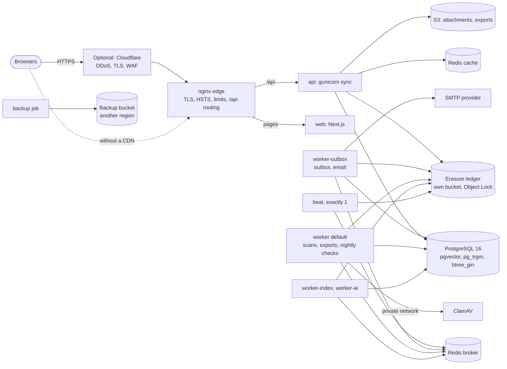

# Deployment readiness: architecture review, hosting options and costs

Prepared 2026-10-12 for the first controlled staging and pilot deployment (deployment
preparation, starting from `f19d968`). It reviews the production architecture as built,
names its single points of failure and limits, and prices two ways to run it: a
minimal-cost controlled pilot and a production environment for 100 concurrent active users.
**Nothing here has been provisioned or bought.** The rules any deployment must follow stay in
[deployment.md](deployment.md); the go-live list is
[production-checklist.md](production-checklist.md); the staging test plan is
[staging-validation.md](staging-validation.md).

The architecture stays a modular monolith ([ADR-0001](adr/0001-modular-monolith.md)): one
backend image runs the API, every worker, beat and the one-off jobs; one frontend image runs
the web tier. Neither option needs Kubernetes or a new service: Docker Compose on a VM runs
the pilot (`infrastructure/compose.production.yml` is that shape, verified locally), and the
production option runs the same images with a managed PostgreSQL.

## Production architecture

### Review by component

| Component | State verified for this release | Single point of failure? | Resources measured ([capacity.md](capacity.md)) | Scaling limit |
|---|---|---|---|---|
| Django API | gunicorn `sync`, `WEB_CONCURRENCY` 8, 30 s worker timeout; production settings refuse insecure or missing configuration at start | pilot: yes; production: yes on one host, no with two behind a load balancer | 100 users: 1.7 cores average, 3.8 peak (of 4); ~620 MB | CPU-bound: 8 sync workers serve 8 requests at once per instance; twice the request rate saturated 4 vCPU (p95 572 ms, 0 errors). Scale out (R76, R114) |
| Next.js web | standalone server, stateless, read-only root, capped tmpfs | as the API | 0.03 cores, ~160 MB | negligible |
| PostgreSQL 16 | two roles; the runtime role can't rewrite history (R13); verified TLS required for any remote host (R115) | yes unless a standby (Multi-AZ) | 0.8 cores average, 2.9 peak; **8-14 connections** at 100 users; page cache ~2 GB of a 7 GB data set | vertical; the heaviest reads are administrators' organisation-wide views (R53, R59) |
| Redis broker | password + TLS required in production; `noeviction`, AOF | no data loss: the durable queue is the PostgreSQL outbox (R10, R16) | 43 clients, 256 MB | — |
| Redis cache | `allkeys-lru`, no persistence | no: misses; request limits per process while it's down (R127) | 256 MB | — |
| Celery workers | four services by queue: `outbox,email`, `default` (scans, exports, nightly checks), `ai_index`, `ai`; every process checks the erasure ledger before any task | per queue: work waits in the outbox until a worker returns | ~150 MB each; the AI processes ~0.5 GB each (embedding model) | Ask Arkray answers queue behind one 1-vCPU `ai` worker: p95 16 s at 50 users asking (R114) |
| Celery beat | exactly one replica | only for timing: relay ticks and housekeeping pause; nothing is lost | ~100 MB | must never run twice |
| nginx edge | memory capped; per-client connection, body and upload limits; JSON 413/429/503 envelopes with request ids; no query strings or one-time links in logs; uploads read only after a session check | pilot: yes; production: per host, behind a load balancer | < 0.1 core, 256 MB limit | slow-body residuals without a CDN (R129) |
| Attachment storage | private S3 bucket (or a volume on one host); downloads streamed through the API; a breaker and 3 calls in flight shared across processes; per-user quota | the bucket (managed, multi-AZ on AWS) | ≤ 10 MB per file | verified against a local S3-compatible fake only (R99) |
| Erasure ledger | its own store, HMAC-chained, conditional writes (`If-None-Match: *`); the API closes when the database is behind it or it is unreadable for over an hour; now exported as `arkray_erasure_ledger_gate_open` with an alert | yes, by design (fail closed, R116) | tiny | across hosts it must be S3: a `file://` ledger works on one host only |
| ClamAV | clamd on a network shared with the scanning worker alone; strict client (only `stream: OK` is clean); signatures older than 3 days fail its health check | scanning only: uploads continue, new files can't be downloaded until scanned | 1.2 GB; up to 3 GB while new signatures load beside the old | one daemon for the measured upload rate; **amd64-only image** (below) |
| Backup and restore | encrypted and signed dumps; restore into an empty database only; the ledger replayed after any restore; point-in-time recovery drilled (`backend/tests/drills/pitr_drill.py`) | the backup job and the key holders | dump 124 s, restore 392 s at 5.6 GB | — |
| TLS | the edge terminates TLS (TLS 1.2/1.3, HSTS one year); every backend hop verified (`verify-full`, `rediss://`, `smtp+tls://`, https S3) | an expired certificate is an outage | — | renewal must be automated and alerted on |
| Secrets | environment variables from a secret manager or a root-only file; production refuses dev, short or reused values ([runbooks.md](runbooks.md#rotate-a-secret)). On the single-VM stack: production-only names (`ARKRAY_PROD_*`) from a file `docker compose --env-file` names (`scripts/init-prod-env.sh` generates it, `scripts/prod-compose.sh` runs every Compose command with it and nothing from the shell), never the repository's `.env`; a guard refuses development, weak and reused values before anything starts; PostgreSQL admits the superuser on its local socket only and the owner from the migrate job's network only (adversarial review of 73ff1e3, M4) | the secret store | — | — |
| Monitoring | `/health/live`, `/health/ready`, `/health/metrics` (bearer token), Prometheus rules in `infrastructure/alerts/arkray.rules.yml`, JSON logs | needs a scraper, a log platform and someone paged **(org)** | — | — |

**Architecture of the hosts.** Every image has only ever been built and verified on
**x86_64 (amd64)**, and the pinned ClamAV digest exists for amd64 only (the PostgreSQL,
Redis, nginx, Python and Node base digests are multi-architecture). Run the application hosts
on x86_64 (Intel or AMD) for the first deployment. Arm hosts (AWS Graviton) would need arm64
builds of both images, an arm64 ClamAV image and a re-run of the verification; a managed
database on Graviton is unaffected, because no Arkray image runs there.

### Single points of failure

| Failure | Pilot (one VM) | Production (one host + managed database) | What users see | Recovery |
|---|---|---|---|---|
| The VM / application host | **everything** | everything but the database | outage | rebuild from the same image digests and the environment file; the database is untouched in production |
| PostgreSQL | on the VM: restore from the WAL archive or a dump | managed single-AZ: the provider replaces the instance (minutes); Multi-AZ: automatic failover (1-2 min) | 503 `service_unavailable`; readiness fails, liveness doesn't | the application reconnects without restarts (Phase 10 drill: 5-13 s after the database returned) |
| Redis broker | on the VM | on the host | nothing; email, scans and indexing wait in the outbox | restart; the relay re-sends (drill: backlog drained in 10 s) |
| Redis cache | on the VM | on the host | nothing | restart |
| Celery beat | one | one | relay ticks and housekeeping pause | restart |
| ClamAV | on the VM | on the host | new files show "being checked" | restart; `ArkrayAttachmentScanOverdue` after an hour |
| nginx | on the VM | on the host (or per host behind a load balancer) | outage of that host | restart; a load balancer routes around a dead host |
| Erasure ledger bucket | S3 | S3 | unreadable for more than an hour closes the API | restore access; never edit `core_erasure_ledger_state` (R116) |
| Object storage | S3 | S3 | uploads and downloads 503; everything else works | provider recovery; reconciliation runbook |
| SMTP provider | external | external | invitations and resets delayed | retried from the outbox |
| TLS certificate | Let's Encrypt on the VM | ACM on a load balancer, or Let's Encrypt | outage at expiry | automated renewal, expiry alert |
| Backup encryption keys | two named people | two named people | a restore of a dump is impossible if both are lost | offline copies ([runbooks.md](runbooks.md#backup-encryption-keys)) |

### Resource needs and scaling limits

- **Web tier first.** At 100 users the API container used 1.7 cores on average and 3.8 at
  peak of its 4; PostgreSQL used 0.8 average and 2.9 peak. The next bottleneck is the API's
  CPU, not the database or its connections (at most 14). More users means more vCPU and
  `WEB_CONCURRENCY`, or a second API instance.
- **Connections.** 100 users never meant 100 connections: gunicorn's 8 workers hold one each,
  the workers connect when they work. A database with `max_connections` 60-100 is enough;
  PgBouncer only when replicas multiply ([hosting-compatibility.md](hosting-compatibility.md#connections-and-poolers)).
- **Memory.** PostgreSQL: `shared_buffers` 25 % of RAM, `work_mem` 16-32 MB (the 4 MB default
  spilled administrators' organisation-wide sorts to disk). ClamAV: 1.2 GB, 3 GB while a new
  signature set loads beside the old (`ConcurrentDatabaseReload yes`); on an 8 GB pilot VM,
  `ConcurrentDatabaseReload no` keeps the peak near 1.3 GB at the cost of scans pausing for
  the reload (about a minute, once or twice a day).
- **Ask Arkray.** Off by default. With it on, the `ai` worker's CPU bounds retrieval answers
  (R114) and the provider's rate limits bound model answers ([ai-evaluation.md](ai-evaluation.md)).
- **Releases.** Some migrations can't run beside the previous release (R108): those releases
  need a short stopped deploy ([deployment.md](deployment.md#upgrading)), announced with the
  edge's maintenance switch ([runbooks.md](runbooks.md#emergency-maintenance)).
- **One tenant per deployment** ([ADR-0011](adr/0011-single-tenant.md)).

## Hosting options and monthly costs

List prices retrieved **2026-10-12** from the providers' official price lists (AWS Price List
bulk files for `ap-south-1`, published 2026-09-11 to 2026-10-10; DigitalOcean's pricing pages
and docs), in USD per month before tax (730 hours; DigitalOcean caps at 672). **Add 18 % GST**
for an Indian business (AWS India invoices IGST 18 %, or CGST + SGST in Delhi; DigitalOcean
charges 18 % or reverse charge with a GSTIN); a GST-registered business can usually claim it
back as input tax credit. Prices change: re-check every line in the provider's calculator
before buying. Items marked *unverified* could not be confirmed on an official page.

Both options keep the data in India (AWS Mumbai `ap-south-1`; backups in another Indian
region, Hyderabad `ap-south-2`). Hetzner was priced as a benchmark only: it has no Indian
region and no managed PostgreSQL.

### Option 1: minimal-cost controlled pilot

For a controlled pilot: about 10-20 active users, a few GB of data, a named group of testers,
an announced support window. One x86 VM runs `compose.production.yml`'s services; S3 holds
the files, the ledger and the backups. Its secrets: `scripts/init-prod-env.sh` writes them to
an owner-only file outside the checkout, and every Compose command runs through
`scripts/prod-compose.sh <file>` (docs/operations.md#production-shaped-stack): never the
file loaded into a shell (an exported variable wins over the file) and never the
repository's `.env`, whose published development values the stack refuses. **An office
behind one shared address** (NAT, guest Wi-Fi) also needs a front proxy that bounds the
whole time to receive a request and the connections per address (HAProxy `timeout
http-request` with `option http-buffer-request`, or a CDN or load balancer that does the
same): without it, one person there can hold the address's sign-in and save slots, or
every connection with slow headers (docs/operations.md#edge-rate-limits; review round 1
of the adversarial review of 73ff1e3, INFRA-3).

| Variant | What runs where | USD / month | With GST |
|---|---|---|---|
| **1a. One VM, self-hosted PostgreSQL** (cheapest) | EC2 **t3a.large** (2 vCPU / 8 GiB, AMD, burstable) running everything, PostgreSQL 16 included with WAL archiving to S3 (WAL-G or pgBackRest in a small image derived from the pinned PostgreSQL one: point-in-time recovery); 40 GB gp3, snapshots, public IPv4; S3 (attachments, exports, backups, the ledger bucket with Object Lock); SES; Secrets Manager | **49.04** (39.11 with a 1-year Savings Plan) | 57.87 (46.15) |
| **1b. One VM + managed PostgreSQL** (recommended once real customer data is in it) | the same VM without PostgreSQL (30 GB gp3, snapshots, IPv4, S3, SES, Secrets Manager as in 1a); RDS for PostgreSQL 16 **db.t4g.small** (2 vCPU / 2 GiB, 20 GB gp3, point-in-time recovery up to 35 days, pgvector 0.8.2 / pg_trgm / btree_gin supported) | **81.41** (db.t4g.medium: 112.07) | 96.06 (132.24) |
| 1c. DigitalOcean BLR1, one Droplet | s-4vcpu-8gb (4 vCPU / 8 GB) with weekly backups, self-hosted PostgreSQL, Spaces; the ledger bucket on AWS S3 (Spaces has no Object Lock) | **62.92** | 74.25 |
| 1d. Lightsail 8 GB bundle | 2 vCPU / 8 GB / 160 GB, 2.5 TB transfer included in Mumbai; Lightsail object storage + an S3 ledger bucket. *Unverified:* x86 (confirm with `uname -m`), and Lightsail's managed PostgreSQL extensions (don't use it for the database) | **48.90** | 57.70 |

What is free and what is paid (AWS, accounts opened on or after 15 July 2025):

- **Credits, not a free tier, pay for the pilot.** A new account gets USD 100 at sign-up and up
  to USD 100 more for five starter activities. On the *Free plan* the account closes after
  6 months or when the credits run out, and Savings Plans can't be bought; on the *Paid plan*
  the credits apply to eligible usage for up to 12 months. USD 100-200 covers roughly 2-4
  months of option 1a, 1.2-2.5 of option 1b. *Unverified:* whether AWS India (AISPL) accounts get the same
  credits.
- **Free-tier-eligible instance types** (paid from the credits) are t3.micro/small,
  t4g.micro/small, c7i-flex.large and m7i-flex.large: too small for this stack except
  m7i-flex.large (2 vCPU / 8 GiB x86, USD 73.55 a month after the credits). The old "750 hours
  for 12 months" offer applies only to accounts opened before 15 July 2025.
- **Always free, every account:** 100 GB a month of data transfer out to the internet
  (across all services), CloudWatch's 5 GB of log ingestion and storage, 10 metrics and 10
  alarms, ACM certificates on a load balancer.
- **Paid from day one:** the VM beyond credits, EBS, the public IPv4 address (USD 3.65), RDS,
  S3 storage and requests, SES (new accounts start on the Essentials plan, USD 0.16 per 1,000
  emails since 21 July 2026), Secrets Manager (USD 0.40 per secret).
- **Cloudflare Free** (USD 0): DDoS protection, TLS and the free managed WAF ruleset in front
  of the VM. Its default request-body handling streams after inspecting a prefix, so nginx's
  own buffering and limits stay on. Behind it, nginx must take the client address from
  Cloudflare's ranges only (`set_real_ip_from` + `real_ip_header CF-Connecting-IP`), or every
  user shares one rate-limit key.

Compute and storage (1a): 2 vCPU / 8 GiB holds PostgreSQL (`shared_buffers` 1 GB), the API
with `WEB_CONCURRENCY=4`, the web tier, the four workers (or two, with Ask Arkray off and
`AI_ENABLED=false`), beat, both Redis, nginx and ClamAV with `ConcurrentDatabaseReload no`,
about 6 GB in all. t3a.large is burstable: 30 % of each vCPU is the baseline (*unverified*,
AWS docs), unlimited mode bills USD 0.05 per vCPU-hour above it (a whole vCPU above baseline
all month: USD 36.50). A 20-user pilot is expected to stay near the baseline (100 users needed
1.7 cores for the API alone); watch the CPU credit balance in the first week.

Backups (1a): WAL archive plus a weekly base backup in S3, about 20-40 GB at pilot size,
USD 0.50-1.00; daily encrypted dumps kept 30 days, under USD 1 more. Network egress: within
the 100 GB monthly allowance at pilot size.

**Operational limits of the pilot:** one VM is a single point of failure for everything (a
host failure means a rebuild from images and a restore: about an hour with the runbooks, a
day if nobody rehearsed it); burstable CPU; operating-system patching and certificate
renewal are the operator's; deploys that need a stopped window take the whole CRM down for
minutes; RPO depends on the WAL archive (1a) or the managed service (1b, 5 minutes); no
second region. Acceptable for a controlled pilot with announced windows; not for 100 users.

### Option 2: production for 100 concurrent active users

Sized from the measured run (100 users, 0 errors, p95 137 ms over a 20-minute hold; twice
the request rate saturated a 4-vCPU API at p95 572 ms with 0 errors). The application host
gets 8 vCPU so the API keeps its 4 cores with the workers, the web tier, the edge and ClamAV
beside it; the database is managed, with point-in-time recovery.

| Variant | What runs where | USD / month | With GST |
|---|---|---|---|
| **2a. Recommended start: one host + managed PostgreSQL, single-AZ** | EC2 **m6a.2xlarge** (8 vCPU / 32 GiB, AMD, not burstable): nginx, API (`WEB_CONCURRENCY=8`, the measured setting; the template's 4 assumes two API replicas), web, the four workers, beat, both Redis (the broker with AOF), ClamAV; RDS for PostgreSQL 16 **db.m7g.xlarge** (4 vCPU / 16 GiB, 50 GB gp3, PITR 14-35 days); an ALB with an ACM certificate; S3 (files, exports, ledger with Object Lock, backups in ap-south-2); SES; CloudWatch Logs; Secrets Manager | **592.37** on demand | 699.00 |
| 2b. Lean: the same with a 1-year Savings Plan on the host and db.m7g.large (2 vCPU / 8 GiB) | only if the staging capacity run on db.m7g.large meets the pass criteria | **375.42** | 443.00 |
| 2c. High availability | 2 × m6a.xlarge (4 vCPU / 16 GiB) in two AZs behind the ALB; RDS db.m7g.xlarge **Multi-AZ**; ElastiCache Valkey (cache and broker, each with a replica) | **1,006.19** (963.71 with a Savings Plan) | 1,187.30 |
| 2d. DigitalOcean BLR1 | s-8vcpu-16gb-amd Droplet + backups; Managed PostgreSQL **Advanced** 4 vCPU / 16 GiB (from 15 Oct 2026 new Standard clusters are capped at 4 GiB with no standby); a load balancer; Spaces; the ledger bucket on AWS S3. *Unverified:* Premium AMD Droplets and PostgreSQL Advanced Edition in BLR1, and whether Advanced's price includes its storage | **426.10** (lean 2 vCPU / 8 GiB: 278.35; with one standby node: about 697.60) | 502.80 |

Line items of 2a (USD): host 162.21; EBS 100 GB and snapshots 11.62; RDS 349.67 + storage
6.55 + backups beyond the free 100 % of storage ~0.95; ALB with one LCU 23.29; three public
IPv4 addresses 10.95; S3 150 GB 3.75 and requests 1.80; egress 10.93 (200 GB, of which
100 GB free); SES 20,000 emails 3.20; CloudWatch Logs 4.25; 8 secrets 3.20.

- **Egress.** A busy month at the measured rate (89 requests a second while 100 people work, a
  few KB each, about 200 working hours) is 200-400 GB: USD 11-33 at USD 0.1093 per GB after the
  free 100 GB. Attachments downloads add to it.
- **Backups.** RDS automated backups are free up to the database's size; the daily encrypted
  dump (about 1 GB compressed at 5.6 GB of data) kept 30 days in ap-south-2 is about 30 GB of
  S3 (USD 0.75) plus the inter-region transfer (*unverified*: not in the price research; a
  few cents per GB). The attachments bucket's versions and replication cost its
  stored size again.
- **ElastiCache in 2c.** Whether managed Valkey keeps `noeviction` and AOF-like durability for
  the broker is *unverified*; the outbox makes a lost broker message harmless (it is sent
  again), so it is acceptable, but verify the eviction policy before relying on it.
- **Burstable instances** (t3a.2xlarge, USD 143.88) would save USD 18 a month on 2a and cost
  more as soon as the API runs above 40 % of each vCPU: not recommended for 100 users.
- **Free tier:** immaterial at this size; the same credits apply once.

**Operational limits of option 2a:** the application host is a single point of failure
(rebuild from images, the database survives); a single-AZ database is replaced by the
provider in minutes but an AZ outage needs a point-in-time restore into another AZ (RTO up to
an hour); capacity is validated only for the measured configuration until the staging run
repeats it on the real hosts (R114).

### Recommendation

1. **Staging and the pilot on option 1b** (t3a.large + RDS db.t4g.small, about USD 81 a month
   before GST): the production topology's managed database and point-in-time recovery from the
   first real record, at pilot cost. Option 1a only if the budget can't take the database.
2. **Run the staging plan** ([staging-validation.md](staging-validation.md)) on it with synthetic
   data, then on option 2's hosts before go-live for 100 users.
3. **Production on option 2a**; move to 2c when the business needs the CRM to survive an
   instance or zone failure without an hour's restore.
4. Put **Cloudflare Free** (or Pro, USD 20-25, for the OWASP ruleset) in front of either, with
   the real-IP configuration above.
5. Set an **AWS Budgets** alert at the expected monthly total (+20 %) before the first
   resource is created, and, if Ask Arkray is enabled, a spend limit in the Anthropic console
   ([ai-evaluation.md](ai-evaluation.md)).

## Decisions and approvals the owner must give

Nothing below has been done; each needs the product owner's or the organisation's explicit
decision.

1. Choose the option (1a/1b for the pilot; 2a/2b/2c for production) and the provider; open the
   accounts; approve the monthly budget (and the GST treatment with the finance team).
2. Approve creating the cloud resources (none exist), the domain and DNS records, the TLS
   approach (ACM on a load balancer, or Let's Encrypt on the VM), and Cloudflare in front.
3. Approve pushing `main` to GitHub and the first CI run on the exact commit (R80 is satisfied
   only by a green run of that commit); configure the GitHub environments `staging` and
   `production` with required reviewers for the release workflow.
4. Provide the production secrets through a secret manager (never the repository), the backup
   encryption key pair (made offline, private key with two named people) and the ledger key.
   Every password and key generated for the environment (`openssl rand -hex 32`; on the
   single VM, `scripts/init-prod-env.sh`), none shared between environments or secrets;
   `manage.py preflight` fails a weak database or Redis password.
5. Accept or reject each residual risk listed in the risk register (the deployment-readiness
   report lists the open ones): this document accepts none on the owner's behalf.
6. Decide Ask Arkray: keep `AI_LLM_PROVIDER=none`, or authorise the real-model evaluation
   (an Anthropic key, a data-processing agreement, the provider's retention settings) before
   any customer data is sent ([ai-evaluation.md](ai-evaluation.md), R68, R69).
7. Confirm RPO ≤ 5 minutes and RTO ≤ 1 hour, the retention periods (R119), the historical-deal
   policy (R118), CPT's unit (R104) and the stricter administrator rule (R110).
