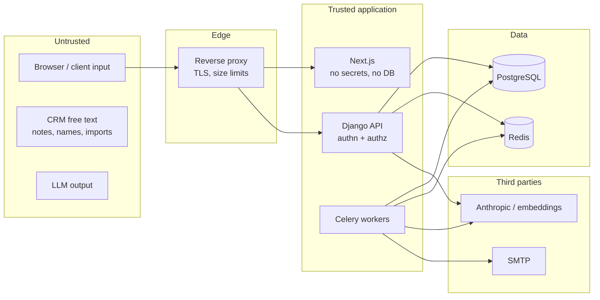

# Security

Threat model, trust boundaries and the controls for each risk. Authorization details are in
[authorization.md](authorization.md), and Ask Arkray-specific controls in
[rag-architecture.md](rag-architecture.md#prompt-injection).

## Assets

1. CRM data: leads' personal data (names, phones, emails), deal values, notes (free text
   that may hold anything a salesperson writes).
2. User accounts and sessions, especially administrators'.
3. Audit trail integrity.
4. Secrets: Django secret key, database, SMTP and AI provider credentials.

## Trust boundaries



- **Everything from the browser is untrusted**, including IDs in URLs, filters, sort keys
  and JSON bodies.
- **CRM free text is untrusted** even when authored by a legitimate user. It is rendered
  escaped in the UI and treated as data (never instructions) by Ask Arkray.
- **LLM output is untrusted.** Tool arguments are validated against strict schemas; the
  narrative is sanitised and grounding-checked before display.
- Only Django and the workers hold database and provider credentials. Next.js holds none.

## Controls by threat

| Threat | Controls | Status |
|---|---|---|
| **SQL injection** | ORM or parameterised SQL only; ruff bandit rules (`S608`); no raw filter or order-by passthrough. Global search's window (`core.ranking`, the one place that writes SQL text) wraps Django-compiled querysets in CTEs adding only constants and identifiers quoted from model metadata; every searched word and scope id is a bound parameter (`test_window.py::test_the_sql_holds_no_searched_text`); quotes, `%`, `_`, backslashes, SQL and regex syntax are literal characters (`test_input.py`) | built (baseline; P7 search) |
| **XSS** | React escapes by default; no `dangerouslySetInnerHTML` anywhere (Ask Arkray answers are typed blocks rendered as text nodes; script, image and attribute payloads tested); API is JSON-only (`X-Content-Type-Options: nosniff`); search results are plain text and their highlighting is built from text slices and `<mark>` elements, never HTML strings (script, attribute, entity and bidi payloads tested); a nonce-based Content-Security-Policy on every page (`frontend/src/proxy.ts`: scripts and styles only from this origin or carrying the page's fresh nonce, no inline code, no `eval` in production, `object-src 'none'`, `base-uri`/`form-action 'self'`; unit-tested and checked in the browser for violations), and the API's JSON carries `default-src 'none'`; `mailto:` links encode header delimiters and lead emails containing them are refused (a lead email could add a Bcc to a colleague's draft) | built (P7 search; CSP and mailto P9) |
| **CSRF** | SameSite=Lax session cookie; over HTTPS the session and CSRF cookies are `__Host-` cookies (Secure, host-only, Path=/: a sibling subdomain can't set or shadow them; P9); Django CSRF double-submit (`X-CSRFToken`) and Origin check on **every** unsafe API request, signed in or not (`core.api.ApiView`), so login CSRF is refused too; a matrix test covers every unsafe route; reads another site makes the browser send (`Sec-Fetch-Site: cross-site` or `same-site`) answer 404 before anything runs ([below](#security-headers); deep security audit L-3, R37) | built (P1; L-3 deep security audit) |
| **IDOR / broken object-level authorization** | workspace-nested routes; every lookup through `AccessScope.apply()`, in the services as well as the views; 404 outside scope, with bodies identical to a missing record; cursors are sealed (encrypted and authenticated), bound to their list, user, workspace and filters, and expire with the longest session (P9: replays across users, workspaces, records, lists and filters are 400s, tested and mutation-checked); the duplicate check looks only inside the caller's workspace; authorization matrix and a cross-user suite (User A vs User B both ways, every channel) | built for leads (P2), pipeline (P3: opportunities, boards, **totals and per-stage values**, history, conversion), activities and timelines (P4), the dashboard (P5: every figure and list), selected-user workspaces (P6) and global search (P7: the scope applied before any word is matched; marked records from every workspace; another workspace's exact secret indistinguishable from nothing); suite P8 |
| **Broken function-level authorization** | DRF global `DenyAll`; per-endpoint capabilities; route-inventory test fails on any unlisted `/api/` route; delegated writes need `crm.manage_any` and ownership changes `crm.assign_any`, checked in the services for every caller and, since Phase 9, before a write's body is even read; the matrix also runs every route as a view-only role (reads pass, every write elsewhere refused) and as a deactivated user's open session (401 everywhere). Team administrators ([ADR-0035](adr/0035-super-administrators-and-teams.md)) hold distinct `*_team` capabilities, never the organisation-wide ones, so any check not written for teams denies them (fail closed); routes open to both name both and the services apply the caller's reach (404 outside it); the matrix runs every route as a team administrator too | built (view-only and deactivated principals P9; team administrators ADR-0035) |
| **Mass assignment** | strict input serializers reject undeclared keys with a 400 (`is_superuser`, `capabilities`, `status`, `password`, `owner`, `created_by`, `archived_at`, ...); the services check fields against their own allowlist too; ownership, status, archive state, provenance, timestamps and version are never directly writable; transitions go through action endpoints | built (P1: users; P2: leads; P3: opportunities: owner, status, stage, closed_at, probability flags, version and provenance are never writable; the owner always follows the lead) |
| **Open redirects** | no user-controlled redirect targets in the API; the frontend's post-login `next` accepts same-origin absolute paths only, checked on the raw input **and** after URL normalisation (the review found `/.//evil.com` resolving to `//evil.com`); no `//`, backslashes, control characters or auth pages (tested); and only a page's shape after normalisation (lower-case `[a-z0-9-]` segments), never `/api`, `/health`, `/_next` or a file (adversarial review of 73ff1e3, L9: `next=/api/v1/workspaces/<id>` made an administrator's browser write a `workspace.accessed` event; R161) | built (P1; L9) |
| **Brute-force login / password spraying** | PostgreSQL-backed throttling keyed by the submitted email (HMAC) and browser, plus per IP; bounded exponential lockout (max 15 min); trusted-browser budgets so attackers can't lock owners out, the trusted-browser cookie bound to the account's credentials so a reset or password change retires every browser trusted before it (P9); refused before the password check; advisory lock against parallel bursts; audited once per threshold ([ADR-0014](adr/0014-durable-login-throttling.md)); an unrecognised browser's budget per account and network (IPv4 /24, IPv6 /64); 50 failures from unrecognised browsers in a day lock the account's sign-in from them until the owner's emailed unlock link, a reset, an administrator or 30 days (trusted browsers unaffected; `ArkraySignInLocked`, `ArkraySignInFailureStorm`); the per-address limit counts unrecognised browsers only; mandatory two-step verification adds protection for Super Admin accounts ([authorization.md](authorization.md#sign-in-throttling)) | built (P1; daily cap L1) |
| **Session fixation / hijacking** | a new session key on every sign-in (also re-sign-in); HttpOnly + Secure + SameSite; 12 h absolute and 2 h idle limits; `session_epoch` in the session hash ends every session on deactivation, email change, password reset and a role change (deep security audit L-2), and old sessions stay dead after reactivation; password change keeps only the current session; a password or own-email change re-checks under the user's row lock that its session is still current (Phase 9 review, P1: a change in flight could undo a password reset that had just ended the attacker's session) | built (P1; P9) |
| **Account enumeration** | identical status, body and cookies for every failed sign-in, with the hasher run in every case (decoy hash), and the same database work whether or not the email has an account (an unknown email's audit rows are written in a savepoint and rolled back; adversarial review of 73ff1e3, L1, superseding R135's acceptance); the daily sign-in lock is identical for unknown emails; throttling keyed by the submitted email, whether or not it exists; password-reset requests do constant work (the job decides eligibility); workspace 404s identical for missing and forbidden users; admin-only 403s never depend on whether the target exists | built (P1) |
| **Privilege escalation via admin impersonation** | no impersonation feature exists; admin workspace access is scoped reads/writes as the admin, audited; a test fails if any route looks like "login as" / "switch user", and the session stays the admin's through a whole workspace visit | built (P0); verified end to end (P6) |
| **Wrong-workspace data on screen** (one user's records under another user's banner) | the workspace comes from the URL, parsed once like the route param and failing closed (a malformed id is "not found", never the organisation or one's own records); the selected-user frame renders only when the URL's and the layout's user agree and canonicalises other spellings; every query key carries the workspace; views remount per workspace; placeholders never cross workspaces; failures show errors, not fallbacks ([admin-user-workspace.md](admin-user-workspace.md#cache-isolation)) | built (P6; the review found and fixed a percent-encoded id showing organisation data under a user's banner) |
| **Privilege escalation via user management** | capability checks (`users.manage`, or a team administrator's `users.manage_team`) in the view **and** under the admin lock in every service; a team administrator reaches only themselves and their team's users (404 for anyone else, before anything about the account shows), creates sales users only, into their own team, and never changes a role or a team (ADR-0035); no self role change or self deactivation; at least one active super administrator always remains; deactivation takes effect on the next request, and a role change signs the user out everywhere (deep security audit L-2, R136); another administrator's (either kind) email and password, and another super administrator's role, can't be changed at all ([below](#administrator-account-protection)); an account whose credentials an administrator changed can't be promoted for 7 days, nor can an account another administrator demoted have its credentials changed for 7 days, and the owner is emailed (adversarial review of 73ff1e3, L3, R156; ADR-0035); a pseudonymised account can't be changed at all (L4, R157) | built (P1; R100; L3, L4; ADR-0035) |
| **Data left on a shared browser** | a sign-in, sign-out or session end reloads the page after rendering nothing; pages restored from the back/forward cache reload; app pages are `Cache-Control: no-store`; other tabs are told (BroadcastChannel) and reload; the viewer is re-checked when a tab regains focus | built (P1) |
| **Account takeover via emailed links** | 256-bit random, single-use, expiring, superseded on reissue, purpose-bound; only SHA-256 digests stored; the secret is minted by the email job so it never touches a web request, the outbox or logs; email changes revoke pending links; link pages send `Referrer-Policy: no-referrer` and `Cache-Control: no-store` ([ADR-0013](adr/0013-account-lifecycle-and-one-time-tokens.md)); the sign-in unlock link (L1) is revoked by an email change, a password set or changed, a reset and a reactivation, its page names the account before anything is used up, and it never takes a browser's trust from another account (adversarial review of 73ff1e3, its review round 1, IDENTITY-1 and IDENTITY-2) | built (P1; unlock link L1) |
| **Audit tampering** | append-only at ORM and DB-trigger level (`audit_event`, `pipeline_stage_history`, `activities_timeline_entry`, and since then `pipeline_negotiation_price` and `pipeline_opportunity_correction`, the corrections of closed deals: adversarial review of 73ff1e3, M2); the trigger binds the application's role only when that role neither owns the tables nor is a superuser (an owner can disable triggers or TRUNCATE: shown by the Phase 9 review), so production runs the app as a separate, non-owner role (P11); the actor is always the authenticated user (body fields, `X-Request-ID` and forwarding headers are never adopted); delegated viewing's audit window lives in PostgreSQL, so no cache entry can suppress an audit row (P9); metadata redacts secret keys and `key=value` secrets, bounds keys, depth and size, drops NUL, control and bidi characters (P9) | trigger built; window and metadata P9; roles P11 |
| **Unsafe file uploads (CSV import)** | size cap (10 MB), extension and content sniffing, parsed in a worker with row limits, stored outside the web root, never executed | designed; import deferred (not in the Phase 2 brief) |
| **CSV/formula injection on export** | cells starting with `=`, `+`, `-`, `@`, tab or CR are prefixed with `'`; exports are streamed and bounded. The data-subject export ([privacy.md](privacy.md#access-requests)) prefixes a formula behind leading whitespace too, and streams in bounded memory (adversarial review of 73ff1e3, M6) | designed; export deferred (the data-subject export built, ADR-0032) |
| **Spoofed or invisible text in CRM records** | names and other text are NFC-normalised; control characters and bidi embedding/override/isolate characters are refused (zero-width joiners kept for Indic scripts); user names follow the same rules since Phase 9 (they took bidi overrides and line breaks into pickers and invitation emails); characters that render blank although they are letters or symbols (the Hangul fillers, the Braille blank and a few others), the whole tag block, every Unicode default-ignorable character but the zero-width joiner and non-joiner, characters unassigned in the server's Unicode data (outside the emoji blocks), and a variation selector outside the defined sequences are refused too, in linear time (adversarial review of 73ff1e3, L12, R164, and its review rounds 1 to 4; [leads.md](leads.md#names)) | built (P2; user names P9; L12) |
| **Duplicate records from retries** | lead create, opportunity create and lead conversion accept an `Idempotency-Key` (per user and operation, 24 h, request digest checked); conversion also locks the lead and refuses a second conversion, so even without a key a double click converts once; the UI reuses a key only for an identical retry and blocks double submits | built (P2, P3) |
| **Aggregate leakage** (totals revealing records the caller can't see) | every total, count and per-stage value is computed from `scope.apply()` first, in the owning module's selector (`pipeline.selectors.pipeline_totals` / `board`, `activities.selectors.activity_summary`, `leads.selectors.lead_summary`); the dashboard only composes them with the request's scope; filters only narrow; organisation-wide figures need `crm.view_all`; tested: A's totals are identical whether or not B has records, A's whole dashboard response is byte-identical before and after B's records exist, and an admin's view of a user's workspace sums that user only | built (P3 pipeline, P4 activity counts, P5 dashboard) |
| **Financial manipulation / float errors** | NUMERIC end to end; amounts only as plain decimal strings or integers (no floats, exponents, NaN, non-ASCII digits); weighted values computed by PostgreSQL, rounded once; CHECKs for won = 100 %, lost = 0 %, value ≥ 0 | built (P3) |
| **Information in URLs** | cursors are sealed (P9: nothing in them is readable, not even sort values or row ids), and personal or business-sensitive sort values (names, deal amounts) are private keys re-read by id, never written into the link; append-only rows (timeline, stage history) show opaque ids, not their global sequence (R48); the re-read goes only through the caller's own scope, so a replayed or harvested cursor can't measure a hidden row's value by where one's own records land (a boundary outside the scope is a 400) | built (P2 names, P3 amounts; scoped re-read P6, review P1) |
| **Answers revealing hidden records** | the "Converted needs an opportunity" check counts only opportunities of the lead's current owner, so a deal someone else closed before a reassignment can't be detected through a 200-vs-422 difference (Phase 3 review); global search returns no counts, its results, sizes, "more" flags and order depend only on the scope's records, and nothing is matched by a related record's text (a kept deal can't be found by its moved lead's name); the residual timing difference is documented (R60) | built (P3; P7 search) |
| **Ownership drift** (an open opportunity owned by someone other than its lead's owner) | database-enforced by a deferred composite foreign key; reassignment moves open opportunities in the same transaction; one documented lock order ([ADR-0018](adr/0018-pipeline-integrity-by-composite-keys.md)) | built (P3) |
| **Secret leakage** | env vars only (`.env` git-ignored, `.env.example` placeholders); production refuses dev or short secret keys (tested); secrets never logged; HTTP-client and AI SDK loggers never log request bodies whatever `LOG_LEVEL` (and production refuses `ANTHROPIC_LOG`); the AI provider key is given to the ai worker only; audit metadata redacts secret-looking keys; the Phase 9 scan of the tree, the whole git history (unreachable objects and stashes included), the images and the logs found no secret | built (P9 scan) |
| **Log injection / id spoofing** | ASCII-escaped JSON logs (control characters and Unicode line separators escaped), and the console format escapes too; correlation ids are minted server-side; a client `X-Request-ID` (validated against `^[A-Za-z0-9._-]{8,64}$`) is adopted only from a trusted proxy, otherwise logged separately and never written to audit; no query strings or bodies logged | built |
| **Request-body decompression bomb** (Phase 2 review, P1, present since Phase 1) | the only parser decodes JSON as UTF-8 and refuses any other `charset` with 415 before reading (Django accepted any Python codec, including `zlib`/`bz2`, so 100 KB inflated to 100 MB, and a body under the 2.5 MB limit to gigabytes, on every endpoint, signed in or not); deep nesting is a 400 | built (P2) |
| **Excessive requests / DoS** | DRF throttles (anon 60/min, user 600/min, scoped stricter limits for login, reset, ask, search (120/min), import); bounded page sizes; statement timeouts; gunicorn timeouts; proxy body-size limits; global search is bounded per request whatever the words (input 2-100 characters, at most 5 words a trigram index can look up, 5 results per kind, a fixed recent pass, and an older pass gated on the index returning under 2 % of records; in one user's workspace only their activities are looked up; 24-120 ms per search at 1M leads / 2M activities, the worst shapes found 0.2-0.5 s organisation-wide (R59); [search.md](search.md#how-a-search-runs)); refused (401/403) requests count against the rate limits (throttles run before permissions), and the edge rate-limits every API route per session, per anonymous address and per address (L2, R155); per-user write budgets and fair background queues: one account can neither delay others' background work beyond one turn per user nor grow a customer past what its export and erasure handle (M6, R153; [reliability.md](reliability.md#fairness-between-users)) (adversarial review of 73ff1e3) | baseline built (P7: search; L2, M6) |
| **Prompt injection / RAG authorization bypass** | scope-bound, read-only tools over the modules' selectors (no SQL, ORM, shell, file or HTTP tool); no owner/workspace parameter in any schema; the tool comparing people absent from one person's scope (offered organisation-wide and in a team administrator's team only); every argument re-validated; vector candidates pre-filtered by owner in SQL, every hit re-read through the caller's scope and hash-checked, text sliced from the live record; user text returned as `untrusted_text`; answers rendered from typed blocks (no HTML, no model URLs), links only to records a tool returned; conversations bound to actor and workspace, history server-written | built (P8): the Rahul/Priya secret matrix over 5 viewpoints × 4 questions with and without an adversarial scripted model (no foreign text reaches the provider or the answer), direct and indirect injection, stale-vector reassignment, malicious tool arguments; each isolation layer mutation-checked |
| **Stack-trace disclosure** | `DEBUG=False` in production (enforced); JSON 500 handler with a generic message and request id | built |
| **Clickjacking** | `X-Frame-Options: DENY` on API and web; CSP `frame-ancestors 'none'` on both (P9) | built |
| **Dependency vulnerabilities** | lockfiles (`uv.lock`, `pnpm-lock.yaml`); `pip-audit` and `pnpm audit --prod` in CI (both clean in Phase 9; the dev-only `braces` advisory is R54); base images pinned by digest, OS packages upgraded at build; Dependabot (`.github/dependabot.yml`: uv, npm, the Dockerfiles' and Compose files' images, GitHub Actions; weekly, one grouped pull request per ecosystem, a 7-day cooldown, security updates at once; the tool images named in workflow scripts are moved by hand; adversarial review of 73ff1e3, L14: before it this row claimed Dependabot with no configuration in the repository, R166) | built |
| **Cache poisoning** (write access to Redis) | the cache never unpickles (django-redis JSON serializer: a write to Redis can't run code in the app); production refuses Redis and broker URLs without a password; nothing security-relevant lives only in the cache (the audit window is a database row, throttling evidence and bulkheads are in PostgreSQL) | built (P9) |
| **Persistence after a container compromise** | the application code is owned by root and read-only to the runtime user (only Next.js's cache is writable); the backend build context is an allowlist, so tests, caches and stray files never reach the image | built (P9) |

## Notes and other activity text (Phase 4)

- Note bodies, task descriptions, meeting agendas, locations and links are never written to
  logs, audit metadata (field **names** only), timeline snapshots, exception messages,
  domain events or analytics; tests assert a secret note never appears in audit or
  timeline rows.
- Lists and timelines return a 240-character preview; the whole text only on the record's own
  page, for someone who may see it.
- Text is normalised and refused if it hides characters (bidi overrides, zero-width
  spaces, the tag block) like every other free text (`core.text`).
- Meeting links: `https://` only (CHECK constraint and validation), no user name or password
  in the URL (they would leak to everyone who can see the meeting), rendered with
  `target="_blank" rel="noopener noreferrer"`.
- A note's text can be edited only by its author, so nobody can put words in someone else's
  name; edits are audited.
- Ask Arkray (Phase 8) embeds notes and task/meeting descriptions **inside the deployment**
  (a local model): their text is never sent anywhere to be indexed, and the index stores no
  text at all. Meeting links and locations are never embedded.

## Product enhancement phase: passwords, support sessions, files, configuration

| Threat | Control |
|---|---|
| An administrator learning a user's password | Never stored or returned in plaintext; admin-set passwords are temporary (forced change, 72 h expiry) and audited; administrators are invited, never given a password, and can't be promoted while one is pending; a sign-in with a temporary password is a security event; administrators see that a password changed, never what it is ([authorization.md](authorization.md#password-change-notification); [password secrecy](#password-secrecy)) |
| One administrator taking over another's account (R100) | Another administrator's (either kind) email and password, and another super administrator's role, can't be changed, whatever the account's status; an account another administrator demoted keeps that protection for 7 days ([below](#administrator-account-protection)) |
| "Log in as" turning into impersonation | Support sessions keep the administrator's identity, bind to their browser session, expire in 30 minutes, open only the target's workspace, refuse identity and security operations, and stamp every write with actor, subject and session ([admin-user-workspace.md](admin-user-workspace.md#support-sessions)); no route named like impersonation exists (tested) |
| Support-session fixation or reuse | The session's marker is server-side and checked against a digest of the browser session's key; a copied marker, a rotated key, sign-out, expiry or a deactivated target ends it |
| Malicious uploads (executables, scripts, HTML/SVG XSS, macro documents, polyglots, zip bombs) | Extension allowlist **and** content recognition; OOXML refused with any macro, OLE object, ActiveX control, or anything fetched from elsewhere when opened (remote template, linked picture/object/media, link to another workbook, data connection): part names and embedded types are checked, and `[Content_Types].xml` and every `.rels` part are **parsed** with defusedxml (no DTD/entities; UTF-8 or UTF-16 only, the declared encoding must agree; a part that doesn't parse refuses the file): refused relationship types (oleObject, attachedTemplate, ActiveX/control, vbaProject, subDocument, frame, externalLink, connections, aFChunk, webextension/taskpane), documents Word imports (altChunk: RTF, MHT, HTML, by relationship, content type or part name) and Office add-ins (web extensions, task panes), and any relationship other than a hyperlink (its exact Transitional or Strict Type URI) whose `TargetMode` isn't `Internal` or whose target is a URL/UNC path (deep security audit M-3 and its review, R132); every other part is judged by what it holds: an OLE compound file is refused, an OOXML package (wherever it sits, whatever it is called) is opened and checked one level deep with the same rules and its own content check (Word fields, workbook formulas) under budgets shared by the upload, and a package under a picture's name or inside another package is refused (adversarial review of 73ff1e3, L7, R159, and its review round 1); a member compressed with anything but deflate or stored is refused unread (R167); spreadsheet formulas that fetch or call out (`WEBSERVICE`, `IMAGE`, `RTD`, `CALL`, `REGISTER`, `EXEC`, `IMPORT*`) are refused in `.xlsx` and `.csv` (L8, R160); each upload's checks share one bounded work pool (about a second of CPU at most), its packages' directories are sized and their records walked before they are parsed, a part named twice refuses the package, and every check also runs against a CPU deadline (`UPLOAD_CPU_SECONDS`, 5 s of the request thread's CPU), so past any of its budgets an upload is refused as "too large to check" (review rounds 1 to 4; `test_upload_parser_costs.py` holds every shape the reviews found to 2 s of CPU and 40 MiB). **The one deliberate exception to "nothing fetched from elsewhere"**: a hyperlink (a document's hyperlink relationship or `HYPERLINK` field, a workbook's or CSV's `HYPERLINK` formula) is kept, because it fetches nothing until someone clicks it, and Office asks first; bounded reads (1 MiB per XML part, 4 MiB in all, 10,000 entries); files served as `attachment` with `nosniff` and a `default-src 'none'; sandbox` CSP; images previewed only when validated; optional ClamAV scanning; a per-person storage quota (`ATTACHMENT_MAX_BYTES_PER_USER`, default 2 GiB; deep security audit L-7, R138) |
| Path traversal and hostile file names | Names are display text (paths dropped, control and bidi characters refused, bounded); objects use generated keys |
| Oversized uploads | Content-Length checked first, then every byte counted while streaming (413); proxy limit on that route only; per-note count under the note's lock |
| IDOR on files, notes, prices, pipelines | Every read and write goes through the caller's scope (404 outside it); downloads re-check the note on every request; tested route by route with another user's ids |
| Custom-field abuse (HTML, formulas, schema growth) | Plain-text names and values (markup refused), typed canonical values, bounded counts and sizes, JSONB values (never DDL), ids audited not values |
| Resource exhaustion at the edge before authentication (deep security audit H-1, R129) | The edge buffers request bodies so slow uploads never hold a web worker; that buffer is a tmpfs, i.e. memory. It is capped (64 MB for uploads and 40 MB for JSON bodies, of the 256 MB container; the JSON area was 16 MB until the adversarial review of 73ff1e3), every client (IPv4 address or IPv6 /64) may have at most 256 requests in flight and 4 attachment uploads, bodies that can reach a temp area (declared over 16 KB, or undeclared) take one of 8 slots per session and 16 per address and small ones one of 128 per address, pages take only a body-less GET or HEAD, and headers must arrive within 10 s, stalled bodies are dropped after 10 s (L13, R165, and its review round 1: one person trickling bodies on an office's shared address had blocked everyone's saves and sign-ins; it was 8 bodies of any size per address). One person on a shared address can still hold that address's small-body slots (its sign-ins and saves get 429), so a deployment where many people share one public address needs a front proxy with a total request deadline and a per-address connection cap ([deployment.md](deployment.md#reverse-proxy), [operations.md](operations.md#edge-rate-limits)). Pre-authentication spooling is limited to JSON bodies: an upload's body is read only for a confirmed session (`auth_request` to `/api/v1/auth/me`, failing closed). Data-export downloads are spooled whole on a disk volume (2 per client, 4 in all), so a slow line neither gets a cut-short ZIP nor holds a gunicorn worker. Verified live with the audit's attack (slow 10 MB uploads trickled to stay open): before, OOM kill after 24 connections; after, 4 held and 26 refused 429 from one address, memory peak 72 MB; from six addresses the temp area filled and the rest got 503, memory peak 93 MB, no kill, the site answered throughout. After the review fixes: 90 unauthenticated slow 10.5 MB uploads from 7 addresses were all answered 401 at once with 0 KB spooled; 80 slow 1 MB JSON bodies from one address held at 8 (72 x 429) with uploads from elsewhere unaffected. Residual ([operations.md](operations.md#edge-rate-limits)): without an account, 3 addresses (1 with undeclared HTTP/2 bodies) can fill the 40 MB JSON area, so JSON writes over 16 KB get 503, and 2 addresses can hold the 4 export-download slots (administrators' export downloads get 429); a signed-in user from 2 addresses can fill the upload area; one person on a shared address can hold that address's small-body slots (its sign-ins and saves get 429), and connections still sending slow headers, which no `limit_conn` counts, affect every client until `worker_connections` and the 10 s header deadline end them (a front proxy with a total request deadline closes both: R165); the edge stays up. Floods of connections (TLS handshakes, idle keep-alives) are bounded by nginx's `worker_connections` (the image's 1024 per worker) and the platform's DDoS protection, not by these limits |

## Administrator account protection

**Policy (R100):** an administrator's credentials are changed only by that administrator,
and a super administrator's role only by an operator (since ADR-0035 a super administrator
may change an Admin's role, below). The audit found that Admin A could change Admin B's sign-in email to a mailbox
A reads and then use *Forgot password* there, or demote B, set a temporary password and choose
a new one at B's forced change: either way A held B's account and B was locked out. Every step
was audited, but nothing stopped it.

**Two kinds of administrator** ([ADR-0035](adr/0035-super-administrators-and-teams.md),
amending ADR-0030): a **super admin** (role `admin`, organisation-wide) and an **Admin**
(role `team_admin`, their own team). The policy covers both kinds
(`identity.services.is_administrator`, `identity.policy.administrator_roles`): a super admin
controls an Admin's role and team, never their password, email or second factor, so nobody
can sign in as an Admin either. An Admin never reaches another administrator at all: every
user-administration route answers 404 for anyone outside their team, as for an account that
doesn't exist, so only super admins edit or off-board Admins.

For another account whose **role** is administrator of either kind (active, invited or
deactivated alike), the API refuses with 422 `business_rule_violation` and a plain reason:

- changing its **email** (the administrator changes it in Settings, with their password);
- **setting its password** (they use *Forgot password*, which mails only their own address);
- resetting its **second factor** (an operator does, below);
- changing the **role** of another **super** admin (demotion; "A super admin's role can't be
  changed by another administrator. To remove their access, deactivate the account.").

A super admin **may change an Admin's role** (to User or Super admin; ADR-0035): it gives
no credential, signs them out everywhere, leaves their team unassigned and revokes their
pending invitations. Because demote, then set a password, was R100's takeover, an account
another administrator (or an operator) took out of an administrator role within
`ADMIN_PROMOTION_COOLING_OFF_S` (7 days) keeps the protection for that long
(**demote-then-unshield**, the mirror of promote-then-shield below): its email, password
and second factor can't be changed by another administrator (422 naming the date), read
from the append-only audit trail (the latest such `user.role_changed`, whoever made it but
the account itself; an operator's, with no actor, counts too).

Still allowed, and audited: editing the name, **deactivating** (sessions end at once, pending
links and the invitations they sent are revoked, and the temporary passwords they set are
voided; it raises `ArkrayAdministratorDeactivated`; a deactivated Admin's team stays assigned
to them, managed by the super admins meanwhile)
and reactivating, resending an invitation. Since ADR-0033 (R126) a reactivated administrator
doesn't get the old password back: it is replaced by a random one nobody knows, sessions and
trusted browsers stay retired, pending reset links are revoked and a new reset link goes to
the account's own address (their second factor is kept). A never-activated one gets an
invitation at its own address; an ordinary user comes back with their own password. The last active **super** administrator can't be deactivated (Admins don't count). Promoting a user to
administrator of either kind is unchanged, except that it signs the user out everywhere (deep security
audit L-2: promoting an account increments its `session_epoch`, so a stale or stolen session,
and a trusted browser, doesn't silently become an administrator's; the user signs in again,
with the second factor the new role may require). The checks run in the service layer, under the
user-administration lock, against the target's locked row, so a concurrent promotion can't
slip between the check and the write (`tests/security/test_admin_takeover.py`, including real
races; the team rules in `tests/security/test_teams_identity.py`, with real races between
demotions, team moves, creations and password sets). The admin Users page doesn't offer the
refused actions for another administrator.

**Promote-then-shield** (adversarial review of 73ff1e3, L3, R156; [ADR-0034](adr/0034-staging-security-remediation.md)):
a compromised administrator could set an ordinary user's password (the owner wasn't told) or
change their email and reset it, sign in as them, change the password and then promote the
account, which R100's rule then put out of every other administrator's reach. Now the owner
is emailed when an administrator sets their password and on any role change, and an account
whose password, email or second factor an administrator changed, or that an administrator
created with a password, can't be made an administrator for 7 days
(`ADMIN_PROMOTION_COOLING_OFF_S`; 422 naming the date, read from the append-only audit trail).
This applies to promotions to either administrator role, and to an Admin's changes of their
team members' credentials too; an account an Admin created counts from its creation (they
chose the address its invitation or reset goes to), and an invited account is never promoted
(its pending invitation goes to an address someone else chose: administrators are invited
with their role). Every promotion to either role raises
`ArkrayAdministratorPromoted`. ADR-0033's acceptance of this path is withdrawn.

**A temporary password goes with its setter's reach** (ADR-0035): when the administrator who
set a user's password loses their reach over the account (the user moved out of their team,
the administrator demoted to User or deactivated), a password still unchanged is replaced by
a random one nobody knows, the account's sessions end, and an active owner is mailed a reset
link (`auth.temporary_password_voided`, in the security events). Otherwise an Admin could set
a password, have the user moved out of their team and still sign in as them
([authorization.md](authorization.md#admin-set-passwords)).

**A pseudonymised former user is final** (L4, R157): every change to such an account (name,
role, email, password, reactivation, invitation, MFA reset, clearing a sign-in lock, a support
session) is refused with 422 `account_pseudonymised`, and the database holds it to its
pseudonym (CHECK `identity_user_pseudonym_final`, trigger `identity_user_pseudonym_kept`), so
no administrator can revive the old account id as a login ([privacy.md](privacy.md#staff)).

**This is a deliberate behaviour change that needs product confirmation**: before it, an
administrator could fix another administrator's email or demote them in the UI.

**When the policy is in the way:**

- *Remove an administrator's access*: a super admin deactivates the account (Users page).
- *Wrong or obsolete email*: the administrator changes it themselves in Settings. If they
  can't (they left, or the invitation went to a mistyped address), deactivate the account and
  invite the right address as a new user; reassign their records if needed.
- *Demote an Admin who stays*: a super admin changes their role on the Users page (*Change
  role*); their team is left unassigned in the same step, so move its users to another Admin
  afterwards if they should stay in a team ([runbooks.md](runbooks.md#admins-and-teams)).
- *Demote a super admin who stays*: ask them to sign out, then an operator with database
  access makes the change in `manage.py shell` and leaves an audit note in the same
  transaction, for example (it works for an Admin too, whose team it unassigns as the API
  does):

  ```python
  from django.db import transaction
  from django.db.models import F
  from django.utils import timezone
  from arkray.audit import services as audit
  from arkray.identity.models import AccountToken, User

  with transaction.atomic():
      user = User.objects.select_for_update().get(email="bina@example.com")
      previous = user.role  # "admin" or "team_admin"
      now = timezone.now()
      User.objects.filter(pk=user.pk).update(
          role="sales_user", version=F("version") + 1, session_epoch=F("session_epoch") + 1
      )
      revoked = AccountToken.objects.filter(
          created_by=user, purpose="invitation", status="pending"
      ).update(status="revoked", revoked_at=now)
      # An Admin's team: leave it to the super admins, as the API does.
      unassigned = User.objects.filter(manager=user).update(
          manager=None, version=F("version") + 1, updated_at=now
      )
      audit.record(
          "user.role_changed", actor_id=None, target_type="user", target_id=user.pk,
          metadata={"from": previous, "to": "sales_user", "revoked_invitations": revoked,
                    "unassigned_members": unassigned,
                    "reason": "operator: <ticket reference>"},
      )
  ```

  It appears in the security events as a role change by the system, and, because it is a
  demotion audited with no actor, the account's credentials stay out of every
  administrator's reach for 7 days (demote-then-unshield). Keep at least one active super
  admin. Unlike the API, it doesn't void the temporary passwords the demoted administrator
  set: for any account still on one (their `auth.password_set_by_admin` events), a super
  admin sets a new one or the owner uses *Forgot password*. To make a super admin an Admin instead (after the upgrade to ADR-0035, for an
  existing administrator who should manage only a team), set `role="team_admin"` and
  `"to": "team_admin"`: the account stays an administrator's, protected as before, and its
  team starts empty until a super admin assigns users to it.
- *Pseudonymise a former administrator*: no administrator can through the API (403, audit
  SEC-2: it replaces the account's email and password). Once the account is deactivated and
  its work reassigned, an operator runs `manage.py pseudonymise_user <id> --by <admin>
  --allow-administrator`, then again with `--yes`; audited as `user.pseudonymised` with
  `administrator_target` ([privacy.md](privacy.md#staff)).

- *Reset a Super Admin's second factor* (lost phone and recovery codes): no
  Super Admin can reset their own through the API (422, ADR-0033). After confirming the person out of
  band, an operator runs `manage.py reset_mfa --email <address> --by <super admin>
  --reason "<ticket>"` (`--by` must name an active super admin, ADR-0035; audited as
  `mfa.reset` by `operator`, that super admin the actor; the owner is emailed); they sign in
  with their password and enrol again.

## Two-step verification

Required for Super Admin accounts only in production (details in
[authorization.md](authorization.md#two-step-verification)). Admin and User accounts cannot
enrol, replace, disable, or use MFA step-up; the retired `MFA_REQUIRED_FOR_ALL_USERS`
compatibility setting is ignored. What it protects: a phished or reused Super Admin password
alone no longer signs in, and a hijacked Super Admin session alone can't
administer users, start support sessions, export or pseudonymise personal data (step-up within
15 minutes), replace recovery codes or turn the factor off. Codes are guessed no faster than
passwords (the durable sign-in throttle counts each wrong code, at setup too, and a right
password never forgives them); wrong codes also accumulate on the device across sign-ins, browsers and step-ups, and 20 in a
row lock the factor (the right code included) until the password is reset by email or set by
an administrator, or the factor is reset, with the owner emailed about the first wrong code
(at most every 6 hours) and the lock, and an alert (`ArkrayMfaLocked`; deep security audit
M-4, R133); 60 wrong codes since the last right one (`MFA_MAX_FAILURES_BEFORE_RESET`) lock
it until an MFA reset, which no new password lifts (`ArkrayMfaLockedUntilReset`; R133: the
password and the mailbox together no longer buy more guesses with each reset); a setup expires after 10 minutes or five wrong codes; the owner
is emailed about every change to their second factor; the browser making a change keeps its
trusted-device cookie, so nobody can lock its owner out by guessing; a code is accepted once
(replay); the secret is encrypted at rest under a key derived from `SECRET_KEY` and survives a
rotation while the old key is a fallback (`manage.py mfa_reencrypt` before retiring it).
Residuals: TOTP is phishable in real time (a proxy relaying the code within its 30-90 s
window); WebAuthn/passkeys would close that and remain a possible addition. An export's
download link, for its requester only, doesn't ask for a new code. Failed sign-ins of existing
accounts are audited; since the adversarial review of 73ff1e3 (L1, R154, superseding R135's
acceptance) a failed sign-in of an unknown email writes the same audit rows in a savepoint and
rolls them back, so both run the same statements and nothing an anonymous caller chose is
kept.

Residual: a super admin can still create or promote *new* administrator accounts of either
kind (that is what the role is for; an Admin creates users only, into their own team);
off-boarding a super admin should include reviewing the administrators they created or
promoted (security events: `user.created`, `user.role_changed`).

## Password secrecy

Nobody, administrators included, can retrieve a user's password (current, previous, temporary
or new), its hash, or a reset or invitation link's secret:

- passwords are stored only as Argon2id hashes (`PASSWORD_HASHERS`); no serializer has a
  password, hash, token or session-epoch field, and every serializer of users is pinned to its
  exact fields by a test;
- a password typed by an administrator (a new user's initial one, or a temporary one) exists
  only in that request: the administrator knows what they typed (ADR-0026), but no API ever
  returns it again, and the user must replace it at their next sign-in. The password a user
  chooses is never visible to anyone;
- reset and invitation secrets are minted by the email job, stored as SHA-256 digests, used
  once, and mailed only to the account's own address;
- `tests/security/test_password_secrecy.py` runs every password flow (initial and temporary
  passwords set by an administrator, the user's own changes, a failed sign-in, a reset by
  email, an accepted invitation, and an unexpected error in the middle of a set-password
  request) with unique canary values, then finds none of the passwords, hashes or link
  secrets in any API response body or header, the audit table, the outbox, the log output at
  DEBUG, any email (and each link only in the email to its own account), the decoded
  sessions, or any text or JSON column of any table (the current hash only in the user's
  `password` column). The password-reset request's outbox payload holds the requested
  *email address* until housekeeping blanks it (SEC-8, accepted), never a secret.

## Client addresses and proxies

The client address that drives rate limits and the audit trail is read from
X-Forwarded-For only when the connecting peer is one of `TRUSTED_PROXY_ADDRESSES` (the edge
proxy's own addresses), and then it is the entry `TRUSTED_PROXY_COUNT` places from the right,
never one the client wrote. Any other peer that reaches the application server directly (a
worker, another container, a misrouted request) is keyed by its own address whatever header
it sends. Production refuses a proxy count without proxy addresses, and a range covering
every address. API rate limits key an IPv6 client by its /64; while Redis is down they are
counted per process in memory rather than lifted (R127,
[operations.md](operations.md#rate-limits-while-redis-is-down)). In the reference stack the
edge has a fixed address on an internal network it shares with the API alone.

## Security headers

| Header | API (Django) | Web (Next.js) |
|---|---|---|
| `Strict-Transport-Security` | 1 year (production) | set at the proxy |
| `X-Content-Type-Options: nosniff` | ✓ | ✓ |
| `X-Frame-Options: DENY` | ✓ | ✓ |
| `Referrer-Policy: same-origin` | ✓ | ✓ |
| `Cross-Origin-Opener-Policy: same-origin` | ✓ | ✓ |
| `Permissions-Policy` | — | camera, microphone, geolocation, payment disabled |
| `Content-Security-Policy` | `default-src 'none'; frame-ancestors 'none'; base-uri 'none'; form-action 'none'` | nonce-based, per request (`src/proxy.ts`) |
| `Server` | `arkray` (no product or version) | — |
| `X-Powered-By` | not sent | disabled |

**Reads another site makes the browser send are refused** (deep security audit L-3, R37):
the session cookie is `SameSite=Lax`, so a link on another site could open an API URL with
an administrator's cookies and write a `workspace.accessed` event in their name. Every API
read (`GET`, `HEAD`, `OPTIONS`) whose `Sec-Fetch-Site` is `cross-site` or `same-site`
answers 404 before anything runs (`core.api.refuse_foreign_site`). `same-origin` (the
app's fetches and download links; the API is only served under the app's own origin,
through the Next.js rewrite and nginx), `none` (an address typed or bookmarked) and a
request without the header (API clients, tests, older browsers, none of which a link on
another site makes send the user's cookies) pass. Unsafe methods were already covered by
CSRF and the Origin check.

**The reference edge** (adversarial review of 73ff1e3, R168, [deployment.md](deployment.md#reverse-proxy))
sends no version (`Server: nginx`, the default server's answers included), offers TLS 1.2
with forward-secret AEAD suites only and TLS 1.3, issues no session tickets, redirects plain
HTTP to one fixed name (never the client's `Host`), drops client-supplied forwarding
(`X-Forwarded-Host`, `Forwarded` and the like), URL-rewrite and method-override headers and
Next.js's internal `X-Middleware-*`, `X-Nextjs-*`, `X-Invoke-*`, resume, revalidate and
action headers, sets `X-Real-IP` itself, refuses `/_next/image` in any letter case, answers
pages only for a body-less GET or HEAD, gives small request bodies a per-address ceiling and
headers a 10 s deadline (review round 1, INFRA-3 and INFRA-7), and rate-limits every API
route per session, per address without a session and per address in all (L2, R155). It
can't bound the whole time a request takes to arrive: where many people share one public
address, a front proxy with a total request deadline is required (R165).

## Secrets management

- Local: `.env` from `scripts/init-env.sh` (generates a strong key). Never committed.
- The template `infrastructure/env/production.env.example` names every secret and the only
  processes that hold it (the provider key in worker-ai, the owner's password in the migrate
  job and restores, the backup keys on the backup host; the web tier and the edge hold none).
- Production: injected by the platform's secret manager as environment variables. Rotation
  is a restart. `DJANGO_SECRET_KEY` rotates without signing anyone out when the previous key
  stays in `DJANGO_SECRET_KEY_FALLBACKS` for a day (Phase 11; tested both ways); a leaked key
  is rotated without it. Every secret's procedure: [runbooks.md](runbooks.md#rotate-a-secret).
- `config/settings/production.py` refuses to start with a missing, short or `dev-`/`test-`
  secret key, or without `DJANGO_ALLOWED_HOSTS` (covered by tests).
- CI scans every commit of the history with Gitleaks (reviewed test values are listed by
  fingerprint in `.gitleaksignore`) and both images' layers with Trivy's secret scanner; a
  finding fails the build. A secret that ever reached a commit is rotated, not just
  deleted: the history keeps it.
- **The production-shaped stack** (adversarial review of 73ff1e3, M4, R151) reads its secrets
  under production-only names (`ARKRAY_PROD_*`) from a file named with `docker compose
  --env-file` (generated by `scripts/init-prod-env.sh`), never the checkout's `.env`, whose
  published development superuser password once filled `${POSTGRES_PASSWORD:?}`; every
  Compose command runs through `scripts/prod-compose.sh <secrets file>`, which first drops the
  shell's `ARKRAY_PROD_*` (an exported variable would otherwise beat the file: review round 1,
  INFRA-5); `credential-guard` (`config/credentials.py`) refuses missing, development,
  placeholder, weak and reused values before anything starts, naming the variable, never the
  value. Weak is under 32 characters, too few different ones, not evenly random, or a repeated
  part, a keyboard or alphabet run, words and numbers joined, or a common password word
  (review round 1, INFRA-4): every value is generated, never chosen. Production settings refuse a published
  development password in `DATABASE_URL` or a Redis URL, and `manage.py preflight --only
  credentials` judges those passwords by the whole rule. CI proves that `docker compose config`
  refuses the stack with `.env.example` as `.env` ([deployment.md](deployment.md#verifying-a-release)).
- **Settings module** (L14, R169): the backend image sets `ARKRAY_RUNTIME=production`, so a
  process in it without `DJANGO_SETTINGS_MODULE` runs the production settings (never `DEBUG`
  or without the database-role check) and any other module is refused, and the development
  and test settings refuse to load whenever `ARKRAY_RUNTIME` is set (`manage.py
  --settings=…` included: review round 1, INFRA-6); gunicorn defaults to the production
  settings outside the image too, an empty variable counting as unset. A host installation outside the image sets
  `ARKRAY_RUNTIME=production` in every service unit.

## Backend TLS

Every connection the backend makes that leaves the machine uses verified TLS, and production
refuses to start otherwise (`arkray.core.transport`, ADR-0032; tested with real handshakes
against a throwaway CA in `tests/security/test_backend_tls.py`):

| Hop | Required | Refused (tested) |
|---|---|---|
| PostgreSQL | `sslmode=verify-full` and `sslrootcert=<CA file>` (or `system` for a publicly trusted certificate) in `DATABASE_URL`; the URL's parameters reach libpq (they were silently dropped before) | no or weaker `sslmode`, a missing CA file at start; a server that declines TLS (downgrade), an untrusted certificate, a host-name mismatch, a missing CA at connect |
| Redis (broker and cache) | `rediss://...?ssl_cert_reqs=required` (`ssl_ca_certs=<CA file>` for a private CA); the broker also gets an explicit `broker_use_ssl` | `redis://`, `ssl_cert_reqs=none/optional`, `ssl_check_hostname=false`; an untrusted or mismatched certificate, a plain-text server |
| SMTP | `smtp+tls://` or `smtps://` (both STARTTLS), or `smtp+ssl://` (implicit TLS, port 465); the system CA store or `EMAIL_TLS_CA_FILE`; TLS 1.2+ | plain `smtp://` to a remote relay; a server not offering STARTTLS; an untrusted or mismatched certificate; a missing CA file |
| Object storage | an `https://` endpoint (or none: AWS's own are https); certificates always verified (`ATTACHMENT_S3_CA_BUNDLE` for a private CA) | an `http://` endpoint; an untrusted certificate |
| ClamAV | loopback or a listed private container name (clamd has no TLS) | any other host |
| Erasure ledger (S3) | an `https://` endpoint | an `http://` one |

The only exceptions are explicit: loopback (a local TLS proxy or sidecar), the single-label
container names listed in `BACKEND_TLS_PRIVATE_HOSTS` (a dotted name or an IP address is
refused there), and the local development stack's `DJANGO_ALLOW_INSECURE_LOCAL_HTTP`, which
production refuses for any public host name. The production-shaped stack runs every hop over
TLS against a private CA (`infrastructure/compose.production.yml`).

Managed PostgreSQL: Supabase and similar services publish a CA certificate: put it in the
image or a mounted secret and point `sslrootcert` at it (their poolers, Supavisor or PgBouncer
in transaction mode, take TLS the same way; `DB_TRANSACTION_POOLER=true` keeps working).
Render's and others' certificate chains were not verified here: use `verify-full` with the CA
they publish, or `system` if it is publicly trusted.

## Database privileges

Two roles in production:

| Role | Used by | Privileges |
|---|---|---|
| `arkray_owner` | the migrate job; an erasure that must redact stage-history lost reasons and agreed CPTs; a DBA's audit purge and index rebuild | owns schema; DDL |
| `arkray_app` | web, workers | `SELECT, INSERT, UPDATE, DELETE` on ordinary tables; **`SELECT, INSERT` only** on the append-only tables `audit_event`, `pipeline_stage_history`, `activities_timeline_entry`, `pipeline_negotiation_price` and `pipeline_opportunity_correction` (the corrections of closed deals, adversarial review of 73ff1e3, M2); no DDL, no TRUNCATE, no TRIGGER; not a superuser and owner of nothing |

The append-only trigger stops UPDATE and DELETE for the app role because that role neither
owns the tables nor is a superuser: a table owner can disable the trigger, switch
`session_replication_role` or TRUNCATE (the Phase 9 review did all three as the development
role). Privileges stop TRUNCATE.

Built in Phase 11 (R74): `infrastructure/postgres/roles.sql` creates the database and both roles;
`manage.py grant_app_privileges arkray_app` (the migrate job, as the owner) grants exactly
the table above, finding the append-only tables by their trigger; and the web server
(gunicorn's master, before forking) and every Celery worker check their own role at start
and refuse to run as a superuser, a role that owns or belongs to the owner of an
append-only table, a role that may UPDATE, DELETE or TRUNCATE one, or a role that can create
objects (`DB_REQUIRE_RESTRICTED_ROLE`, on in production; `manage.py check --deploy
--database default` reports the same in the release pipeline). Verified live on the
production-shaped stack: as `arkray_app` every one of the review's attacks is refused, and
started as the owner the web server exits and the worker exits (`database_role_refused`).
The development stack still runs as one superuser and opts out explicitly.

**Who connects from where** (adversarial review of 73ff1e3, M4, R151): on a self-hosted
server `infrastructure/postgres/pg_hba.conf` (the production-shaped stack mounts it) admits
the superuser on the local socket only (inside the PostgreSQL container and the one-shot
role setup, which has no network), physical replication only for the superuser on that
socket (pg_basebackup, pgBackRest, WAL-G), `arkray_owner` over TLS from the migrate job's
network only (`db-owner`, 10.252.17.16/28), `arkray_app` over TLS from the server's own
networks, both only to `arkray` and `arkray_restored` (the restore's database, renamed into
place afterwards: review round 1, INFRA-1 and INFRA-2), SCRAM everywhere, and rejects
everything else; on a managed database the provider's network rules do the same. Verified live: from the API container the superuser and the owner are refused
and the application role connects; the owner connects from migrate; the superuser is refused
even over loopback TCP; the documented restore ran end to end on that file (round 1).
`roles.sql` refuses role passwords under 32 characters or one shared by both roles.

## Personal data

- What is held, where, for how long, and how access and erasure requests are met:
  [privacy.md](privacy.md). Erasure is `manage.py erase_lead` (Phase 11): the lead's
  personal fields, its activities' and opportunities' text, the lost reasons in the stage
  history, the derived index chunks and stored answers, in one audited transaction.
- Logs are written by allowlist (ADR-0032): known identifier, code and count fields only,
  exceptions by type and frame without their messages, third-party messages sanitised, the
  client address on the access line only ([observability.md](observability.md#what-a-log-line-may-hold));
  container logs rotate. Lead audit events record field **names** and status keys, never values; a lead's
  `str()` is its id (tested with a lead full of contact data through create, search,
  duplicate check and a failed edit). Opportunity audit events and domain events carry
  ids, stage keys and statuses only: no titles, amounts, descriptions or lost reasons;
  an opportunity's `str()` is its id. A closed opportunity whose lead has moved to
  another workspace shows the lead as `restricted` (its name is not sent).
- The Leads UI keeps searches and filters in memory only, never in URLs, browser history
  or storage; the dashboard's cards preset those in-memory filters rather than putting
  them in a link.
- The dashboard (Phase 5) shows leads' names, organisations and assigned users' names only
  (no email or phone number is sent), and its meeting and task rows carry no description,
  agenda or author (security review); its responses are `no-store` and never logged; the
  browser keeps no copy once the page is left (`gcTime: 0`). Viewing your own dashboard
  writes no audit event; an administrator's delegated view is audited once per window.
- Global search (Phase 7) stores nothing: no history, recent searches or analytics, and its
  READ ONLY transaction makes PostgreSQL refuse any write. The query is never logged,
  audited or echoed in an error (tested on every log record for 200, 400, 404 and a real
  statement timeout); the dialog never puts it in the page URL, so it stays out of browser
  history; results are kept in memory for a minute at most and never in browser storage.
  Notes leave the database only as a 240-character preview around the match, with no
  author. The query does travel in the request URL (as the Leads search's): the reference
  proxy logs paths without query strings (R61; verified: a search term reaches no log).
- Data sent to AI providers is minimised and masked before it is sent, history and question
  included, and every preview is masked on the whole text before it is cut (phone numbers in
  any common Indian shape, passcodes and credentials, identity and card numbers; adversarial
  review of 73ff1e3, M5, R152, and its three review rounds: linear on any input, and a
  reference or currency word keeps the figure after it only as a label right before it, never
  across a sentence's end; [rag-architecture.md](rag-architecture.md#privacy-and-data-minimisation));
  AI can be disabled entirely and the language model is off by default.
- Deleting an Ask Arkray conversation answers the same (204, the same headers, the same
  work) whether or not a legal hold keeps it; a held one becomes a hidden tombstone that
  housekeeping deletes after the hold's release (adversarial review of 73ff1e3, M1, R148: the
  409 it answered before was an organisation-wide legal-hold oracle;
  `tests/security/test_ask_hold_oracle.py`; [privacy.md](privacy.md#legal-holds)).
- The audit trail's personal details (client addresses of security events, old/new emails,
  reset requesters' addresses, support reasons) expire after 90 days in `audit_event_detail`;
  exports, correction, staff pseudonymisation, legal holds and the restore-safe erasure
  ledger are described in [privacy.md](privacy.md).
- A closed deal's previous owner sees it without the customer's identity and contact
  details, and without the deal's free text (description, lost reason, work load, CPTs and
  the histories' reasons: adversarial review of 73ff1e3, L6, R118), on every surface, Ask
  Arkray's tools included ([authorization.md](authorization.md#historical-deals)).
- A won or lost deal's value, probability and dates are frozen for every normal edit;
  administrators correct them with a reason, and the figures before and after go to an
  append-only table (adversarial review of 73ff1e3, M2, R149; [pipeline.md](pipeline.md#closed-deals)).

## Security testing

Automated: authorization matrix and cross-user suites, CSRF enforcement on every unsafe
route, throttling and enumeration tests, real-concurrency race tests, secret-hygiene scans
of logs, audit, outbox and responses, dependency-outage tests, production-settings tests,
ruff bandit rules, `pip-audit`, `pnpm audit`. Phase 9 adds a manual threat-model review, header and CSP verification, and
a focused penetration test of authorization, admin workspace and Ask Arkray.
